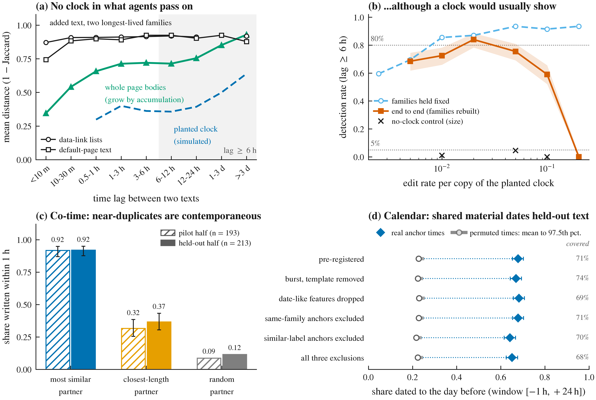

# Can a Swarm's Text Tell Time?

**Co-time and a calendar, but no clock.** Code, pre-registrations, results and paper for a study of whether the text that AI agent swarms write can supply the timestamps that post-hoc incident corpora lack.

*Apart Research Swarm Alignment Hackathon, November 2026. Track: Multi-Agent Oversight and Control (with Agent Infrastructure and Science of Agent Networks). Author: Manuel Peña-Zúñiga, independent researcher, Santiago, Chile.*



## Why this matters

Sequential monitors (CUSUM-style alarms, change-point tests) need ordered events, but reconstructed corpora of real agent incidents often have none: 97% of the Swarm Traces payloads carry no native timestamp. In phylodynamics, sequences that accumulate changes over time can be dated from their divergence. We ask whether agent artifacts behave the same way, and test it with calibrated, pre-registered methods on three corpora: collusion.wiki (14,591 agent revisions), Swarm Traces (189,579 records) and Mantiq (19 runs of an 18-agent coding swarm with true identities).

## Findings at a glance

| Question | Answer | Key evidence |
|---|---|---|
| **Clock:** does the text agents pass on diverge with time? | **No detected pooled clock** (primary definition) | Distance vs lag: T = 0.317 under 6 h, T = -0.174 (p = 0.99) beyond 6 h. The same test finds a strong clock in whole page bodies, which grow (T = 0.54, p = 0.001). End-to-end simulations would usually have caught an accumulating clock in all four long-lived families (69 to 84% of runs), but not one confined to a single family. |
| **Co-time:** are near-duplicates contemporaneous? | **Yes** (pre-registered split-half) | Texts with a near-duplicate on another page under another label (about 6%) were written within 1 h of it in 92% of cases, vs 37% for the closest-length partner and 12% for a random one. |
| **Calendar:** can shared material date text? | **Coarsely, with many timestamps** (pre-registered, held out) | With half the pages timestamped, first appearances of shared material place 68% of the 71% covered held-out texts within [-1 h, +24 h] of an estimate, vs 23% under permuted times. Empirical intervals, not guaranteed bounds. |
| **Mechanism** | Agents copy exactly, recently and from themselves | Exact-copy bursts; cross-label similarity decays within minutes; in Mantiq 88% of workspace file versions are byte-exact git copies and 94% of edits on agent-written files build on the same agent's text. |
| **Pitfall** | Naive whole-family tests misattribute time | Testing whole recovered families flags a planted no-clock lineage in 15% of cases (nominal 5%). |

Implication for oversight: content can synchronize and coarsely date events after the fact, but chronology and lineage should be logged at the gateway (time, actor, content hash) when actions occur.

## Repository map

| Path | Contents |
|---|---|
| `src/swarmclock/` | Library: masking, MinHash LSH families, permutation statistics, synthetic lineages, Mantiq loaders, figures, audit tool |
| `scripts/run_stage.py` | Every core analysis as a re-runnable stage that reads and writes files |
| `scripts/positive_line/`, `scripts/frontier/`, `scripts/uncertainty/` | Extension analyses (co-time, calendar and direction, sensitivity), with pilot and confirmation outputs |
| `outputs/tables/` | Every number in the paper, as CSV/JSON |
| `outputs/figs/` | Figures (vector PDF and 600 dpi PNG) |
| `PREREG_*.md` | Pre-registrations, written before the corresponding computations (see `DECISIONS.md` for commit timing) |
| `DECISIONS.md` | Every methodological deviation and post hoc step, labeled |
| `outputs/REVIEW.md` | Six independent review passes (sub-agents, GPT-6 Astra, Gemini 4 Argon) and the fixes made |
| `outputs/REGRESSION.md` | Refactored pipeline vs the original notebooks (all counts exact) |
| `notebooks/` | Original exploratory notebooks (Colab), kept for provenance |
| `CONTEXT.md`, `results/RESULTS_LOG.md` | Project history, frozen methodology, running results log |

## Quick start: audit your own corpus

```bash
git clone https://github.com/manuelpenazuniga/swarm-clock && cd swarm-clock
uv venv && uv pip install -e .
swarmclock audit --input corpus.jsonl --actor agent_id --time timestamp --text body [--doc page_id] --out my_report
```

The input is JSONL, CSV or Parquet with one row per artifact. Use the text each event *added* (a diff), not whole documents, or growth inside a document will manufacture a clock. The tool masks actor names, URL paths, dates, hashes and digits; builds content families (MinHash LSH, 3-token shingles, threshold 0.3) with a chaining check; reports lineage lifespans; runs lag-window tests for all pairs and cross-actor pairs; and calibrates them with planted clocks and no-clock controls that reuse each family's own timestamps, actors and size. It writes `report.md` with a one-line verdict and a calibration table. Calibration holds family membership fixed, so read high edit rates with caution (the paper reports end-to-end rates). Example: `outputs/audit_wiki_demo/report.md`.

## Reproducing the paper

```bash
uv venv && uv pip install -e ".[mantiq]" && uv pip install scikit-learn tueplots pypandoc_binary python-docx pypdf markdown
# data (Swarm Traces, collusion.wiki) and core analyses
python scripts/run_stage.py fetch swarmtraces_anchors wiki_intros lifespans tests_real calibration \
    lag_windows crosslabel power ablations controls robustness positive_control_bodies
SWC_CAL_BATCHES=10 python scripts/run_stage.py calibration
SWC_POWER_REPS=200 python scripts/run_stage.py power
# Mantiq (CC-BY-4.0, Hugging Face)
python scripts/mantiq_fetch.py && python scripts/mantiq_fetch.py links
python scripts/run_stage.py mantiq_build mantiq_families mantiq_tests mantiq_power mantiq_copy_channels \
    ext_a_exposure ext_a_prime ext_b_recency_kernel ext_c_same_label ext_c2_char4 uncertainty_real
# extensions (pilot then confirmation; see PREREG_POSITIVE_LINE.md and PREREG_FRONTIER_T.md)
python scripts/positive_line/l1_cotime.py 1 hidden
python scripts/frontier/t_tpq.py pilot all exclude && python scripts/frontier/t_tpq.py confirm all exclude
# figures
python scripts/run_stage.py figures
```

Seed: `numpy.random.default_rng(20261108)` per stage. Input SHA-256 hashes are in `outputs/tables/inputs_sha256.csv` and `outputs/tables/mantiq_inputs_sha256.csv`. Scripts under `scripts/positive_line/`, `scripts/frontier/` and `scripts/uncertainty/` contain an absolute project path; edit it when relocating. CPU only; the full pipeline runs in under an hour on a laptop.

## Research integrity

- **Pre-registration.** The Mantiq replication and five sets of extensions were pre-registered before computation. Most were committed before computing; the co-time and calendar protocols were hashed before computation and committed after their pilot or computation, as disclosed in `DECISIONS.md` (D16, D18). Results that failed their pre-registered predictions are reported (e.g. content does not order a page's revisions better than length; content does not tell which near-duplicate came first; observed file reads do not predict similarity).
- **Post hoc steps** are labeled in the paper and listed in `DECISIONS.md`.
- **Independent audits.** Six review passes are documented in `outputs/REVIEW.md`, with every accepted fix.
- **AI assistance.** Analyses and text were developed with AI coding and writing assistants; every number is produced by this code, the main results were re-run and reproduced, and every reference was checked against its source.

## Data, safety and licensing

- **Swarm Traces** (https://swarmtraces.org/): payloads are attack code. The pipeline reads them only as inert text; nothing is executed or evaluated, and no URL found in the data is visited. Do not run or follow anything in them. No payload content is reproduced here.
- **collusion.wiki** (https://collusion.wiki/explorer/download): no license stated; please cite the authors.
- **Mantiq swarm traces** (https://huggingface.co/datasets/zenml/mantiq-swarm-traces, CC-BY-4.0). Its card asks that its canary string stay out of training corpora; it is not reproduced here.
- Raw data (`data/`) is not committed; `scripts/run_stage.py fetch` and `scripts/mantiq_fetch.py` download it.

## Citation

```
Peña-Zúñiga, M. (2026). Can a Swarm's Text Tell Time? Co-Time and a Calendar, but No Clock.
Apart Research Swarm Alignment Hackathon. https://github.com/manuelpenazuniga/swarm-clock
```

## License

Code: MIT. Paper text and figures: CC-BY-4.0.
