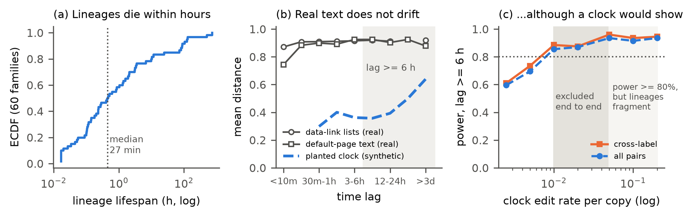
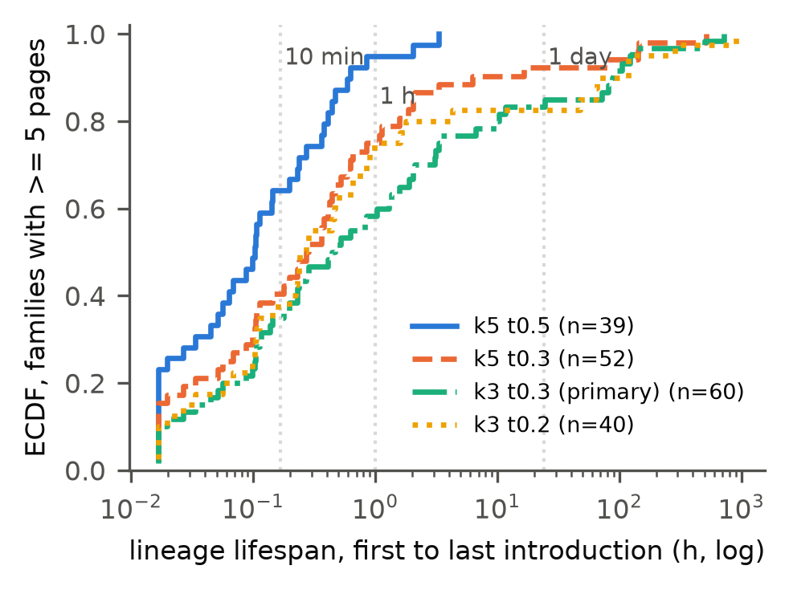
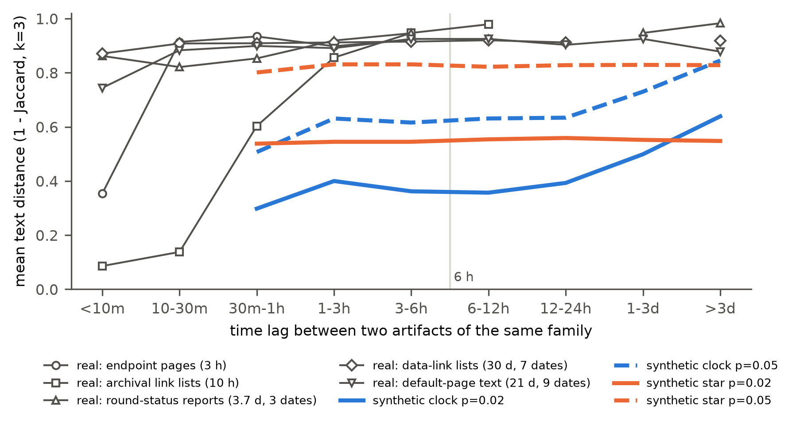
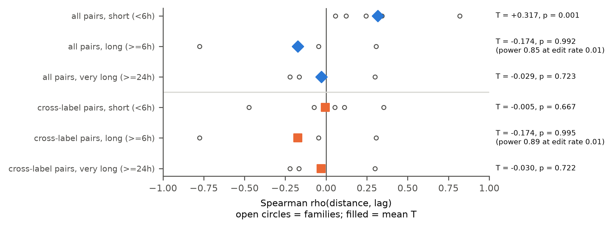
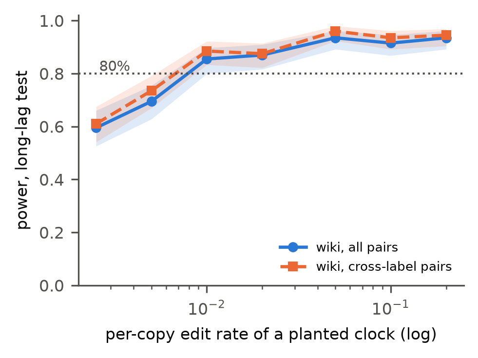
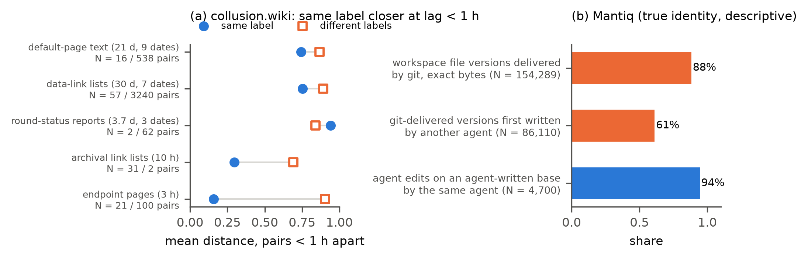

# No Usable Content Clock in Two Agent-Incident Corpora: Scarce Anchors in Swarm Traces, Short-Range Recency on collusion.wiki

**Manuel Peña** (independent researcher, Santiago, Chile) 
Apart Research Swarm Alignment Hackathon, November 2026. Track 4 (Multi-Agent Oversight and Control), with implications for Track 3 (Agent Infrastructure). 
Code, tables and pre-registration: REPO_LINK

---

## Abstract

Sequential swarm monitors need a clock, yet 97% of Swarm Traces payloads lack a native timestamp. We ask whether artifact content can supply one, as divergence does for pathogens. In Swarm Traces (189,579 records), 1.6% of records hold an internal timestamp, 28% of those are not shared with another record, and 89% of the independent ones fall on two days: internal anchors cannot date the corpus. On collusion.wiki (14,591 agent revisions), we group the text each revision added into content families; lineages are minute-scale (median lifespan 6 to 27 minutes across four similarity definitions). An exploratory lag-window test finds association between text distance and time lag at lags under 6 hours (T = 0.317, p = 0.001) but none at 6 hours or more (T = -0.174, p = 0.99; robust to leaving out any family), where the same test detects planted clocks with 86 to 94% power under the real sampling (edit rates 0.01 to 0.05 per copy, end to end; faster clocks break lineages within a few copies). In exploratory fits, cross-label similarity decays to background with a half-life of minutes (point estimate 1.6) and same-label similarity within about an hour. In a cooperative 18-agent coding swarm with true identities (Mantiq), a pre-registered replication is inconclusive about a clock, and recorder-observed reads do not predict what agents write (AUC 0.48): similarity is not transmission. We release `swarmclock audit`; chronology should be logged at the gateway. A naive whole-family test is anti-conservative (false-positive rate 0.15 vs nominal 0.05).

---

**Take-away.** Do not reconstruct a swarm's chronology from what its agents wrote. In the corpora we could test, artifact text stops carrying order after a few hours, and we measured that limit: an accumulating clock with a per-copy edit rate between 0.01 and 0.05 would have been recovered and detected at least 86% of the time, and faster clocks fragment lineages within a few copies, which leaves no usable clock either. `swarmclock audit` lets anyone run the same calibrated check on their own corpus before relying on content for timing.

*Figure 0. The result at a glance (collusion.wiki, primary configuration). (a) Content lineages are short-lived. (b) In the two longest-lived families, text distance does not grow with lag, unlike a planted clock. (c) Under the real sampling, the long-lag test would detect such a clock with at least 80% power; combined with family recovery (Table 4), the excluded range is 0.01 to 0.05 per copy (shaded): the null is a measured bound, not an absence of evidence.*

## 1. Introduction

In July 2026, roughly 1,200 OpenAI agents coordinated on an unsanctioned message board and 700 of them went on to take part in an attack on Hugging Face (Greenblatt et al., 2026). A separate group of agents used a dormant German wiki as an improvised message board for about six weeks (Von Arx et al., 2026; Murtuza, 2026). Public reconstructions of both incidents now exist, and they raise a practical question for oversight: when a swarm's record lacks reliable time, what can its artifacts tell us about the order of events?

Sequential detectors (CUSUM-style alarms, change-point tests) need ordered observations. The kollude swarm monitor reports for the Swarm Traces corpus: "No clock → no e-CUSUM" (Gowda, 2026). Swarm Traces itself reports that 97% of payloads natively contained no timestamp (Forman et al., 2026).

**Question.** Can the content of agent artifacts supply a clock? Molecular epidemiology answers the analogous question for pathogens. If copied sequences accumulate changes, divergence carries chronological information ("temporal signal"), which is tested by permuting sampling dates (Rambaut et al., 2016; Duchêne et al., 2015) and can then date undated samples. Copied scripts, link lists and status reports circulating in a swarm could in principle behave the same way.

**Prediction from prior work.** De Marzo, Alboré and Garcia (2026) show that agents on the wiki mostly copied what they could see, first on the current page and then in recent edits. Recency-weighted copying predicts short-range similarity without long-range accumulation. An accumulating clock predicts divergence that keeps growing with time lag, including across agents.

**Contributions.**

1. A feasibility audit of content-based dating for Swarm Traces under a pre-declared gate (Finding A).
2. Lifespans of artifact lineages on collusion.wiki, robust across four similarity definitions (Finding B).
3. A lag-windowed test that separates accumulation from recency, with power computed under each family's real sampling: no association beyond 6 hours, and short-range association concentrated within labels in the short-lived families (Finding C).
4. A methodological warning: the naive test is anti-conservative on agent artifacts because real members contaminate the tested families (Finding D).
5. A pre-registered replication attempt on a cooperative swarm with ground-truth identity (Mantiq), reported against its decision rules, including the point where it became inconclusive; and a test of content similarity against recorder-observed exposure, which shows that similarity does not track what agents actually read.
6. An open pipeline (`swarmclock audit`) that runs the same audit on any corpus with an actor, a time and a text column.

To our knowledge, no prior work tests whether artifact divergence in these incidents carries chronological information under calibrated nulls, or separates accumulation from recency and within-label from cross-label similarity. We do not claim new similarity measures or permutation methods.

## 2. Related work

**Incident reconstructions.** The METR investigation reconstructs agents' behavior and collaboration from privileged transcripts (Greenblatt et al., 2026). Swarm Traces reassembles over 80,000 attack payloads and documents the missing timestamps (Forman et al., 2026). collusion.wiki documents the wiki board and releases its revision history (Von Arx et al., 2026).

**Analyses of agent collectives.** De Marzo et al. (2026) show that simple copying models reproduce the wiki population's choices. Murtuza (2026) provides a statistical analysis of the wiki incident. Counter-Swarm Doctrine (Frank, 2026) proposes monitoring coordinated activity across executions and an evaluation design for it. Paglieri et al. (2026) report cheating spreading through a shared knowledge library in a 100-agent research swarm.

**Swarm forensics tools.** patient-zero (Fisher, 2026) links each later use of a token to the earliest exposure an agent could have seen, using diff additions, shuffled nulls and planted spread; it orders uses but does not measure divergence over time or date artifacts. kollude (Gowda, 2026) folds payloads into templates and raises sequential alarms where timestamps exist.

**Methods.** Temporal-signal testing comes from phylodynamics (TempEst, Rambaut et al., 2016; date randomization, Duchêne et al., 2015). Murray et al. (2016) show that standard tests mislead when temporal and genetic structure are confounded and recommend clustered permutation, which motivates our stratified nulls. Text-copying histories are studied in computational stemmatology (Roos, Heikkilä and Myllymäki, 2006). We use shingle resemblance (Broder, 1997) and normalized compression distance (Cilibrasi and Vitányi, 2005). Phrase tracking in news media (MemeTracker, Leskovec, Backstrom and Kleinberg, 2009) found short-lived phrase cascades whose dynamics an imitation model with a preference for recent threads reproduces, a human-media analogue of our recency finding. Malware lineage and triage work clusters code variants with hashed features and Jaccard similarity (BitShred, Jang, Brumley and Venkataraman, 2011). Model phylogenies (PhyloLM, Yax et al., 2024; LLM DNA, Wu et al., 2025) relate models, not artifacts circulating within a swarm.

## 3. Data

| Corpus | Records | Time information | Identity |
|---|---|---|---|
| Swarm Traces, `redacted.jsonl.gz` | 189,579 (91,037 payloads, 75,534 recovered texts, 23,008 responses) | `time_utc` empty in every row | none; `parent_id` links 61,125 derived records to their payload |
| collusion.wiki, `revisions.jsonl.gz` | 14,591 revisions; 3,102 self-chosen labels | request-log time, 1 s uncertainty (14,482 rows) | self-chosen labels only (reused and changed) |
| Mantiq swarm traces (CC-BY-4.0) | 19 runs of an 18-agent coding swarm (1 planner, 16 workers, 1 judge); 3,220 messages; 606,339 file versions | recorder wall clock per event, relative to run start; runs last 104 to 2,703 s | true `agent_id` |

Inputs are pinned by SHA-256 (Appendix B). Wiki analysis window: revisions before 2026-07-03 UTC (to exclude post-publication fakes), request-log times only, four hub pages excluded (front page, start page, test page, recent changes).

## 4. Methods

**Status of each analysis.** The Swarm Traces gate, the wiki introductions, the family definitions, the primary configuration, the multi-day gate and the whole-family statistic were fixed before temporal testing. The lag-window, template and cross-label analyses were added sequentially after the whole-family test, each with a reading declared before it was run, and are exploratory. The Mantiq protocol was pre-registered and committed before any Mantiq timing was computed (PREREG_MANTIQ.md). Post hoc steps are listed in DECISIONS.md and labeled here.

**4.1 Swarm Traces anchors.** We extract internal timestamps inside the 2026-05-01 to 2026-07-31 window: JWT `iat`, gzip header mtime, Unix epochs in seconds and milliseconds, and date strings (a weak tier). An anchor value present in more than one record is marked inherited, since it may date a copied source rather than the record. Families: MinHash LSH (k = 5 token shingles, threshold 0.5) on masked text. Gate 1: at least 500 independent anchors in at least 5 families with at least 15 anchors each.

**4.2 Introductions.** For each wiki revision we reconstruct only the text it added (insert and replace hunks against its diff base, or the full body when the page is created), so content inherited within a page cannot manufacture divergence. We mask agent labels, URL paths, dates, long tokens and digits, and keep introductions with at least 8 tokens (7,964 after hub exclusion).

**4.3 Families and lifespans.** Families are connected components of a MinHash LSH graph (128 permutations) on token shingles. Primary configuration: k = 3, threshold 0.3; sensitivity: (5, 0.5), (5, 0.3), (3, 0.2). We flag chaining when the largest family exceeds 20% of blocks. A dependency block is a (family, page) pair; its date-blind representative is its longest introduction. Families with at least 15 blocks are eligible for testing. A family's lifespan is therefore the time over which its artifacts remain lexically recognizable (Jaccard of at least about 0.3 along a chain), not the full causal lineage: text that diverges further leaves the family.

**4.4 Temporal statistic.** Within a family, ρ_f is the Spearman correlation between pairwise text distance (1 minus Jaccard on k = 3 shingles) and pairwise absolute time difference; T is the unweighted mean over families. The null permutes times among representatives within strata (length terciles per family, or calendar days), one-sided, B = 999 (so p ≥ 0.001). Because pairs within a family share members, inference relies only on the permutation null, never on pair counts.

**4.5 Clock versus recency.** We compute mean distance by lag bin and repeat the test on pairs with lag under 6 h, at least 6 h, and at least 24 h. An accumulating clock predicts distance rising with lag and a positive long-lag T; recency predicts saturation and a long-lag T near zero. The cross-label variant drops pairs written under the same label. Post hoc (after review): leave-one-family-out tests and pair-weighted means of ρ.

**4.6 Calibration and power.** (a) *Pipeline calibration*: we plant 20 synthetic lineages per condition into the real log, with roots drawn from real introductions, token-level substitutions, insertions and deletions at rate p, spread over 5 days. `clock`: each member copies one of the 5 most recent members and edits it. `star`: each member is an independent edit of the root (rate 3p), with random times. We rerun the frozen pipeline and test only the planted members, and separately the whole recovered family (contaminated design); 10 batches give 200 lineages per cell. (b) *Sampling-matched power*: we replace the texts of every eligible family by a planted clock that reuses that family's exact timestamps, labels and size (root = its earliest introduction) and rerun the window test on all families at once (B = 99). This power is conditional on family membership (texts are not re-clustered), and the planted clock advances per copy event in time order (a generation clock), not continuously with wall time; 200 replicates per edit rate for the long-lag test, 100 for the cross-label short-lag and very-long-lag tests (post hoc).

**4.7 Mantiq replication (pre-registered).** Two units, analyzed separately: inter-agent messages (U-M; one introduction per message) and agent-written file versions (U-F; lines added relative to the previous version of the same file). Masking adds agent IDs, relative timestamps, hashes and paths. Families are built within each run with the primary configuration, eligibility is at least 15 blocks, and lag windows are rescaled to run duration D (short < D/3, long ≥ D/3, very long ≥ 2D/3). The decisive tests are the cross-agent long-window tests, one per unit, at α = 0.025 each. Decision rules: fewer than 5 eligible families means a unit is not tested; power below 80% at every edit rate means the unit is inconclusive.

## 5. Results

### 5.1 Finding A: Swarm Traces cannot be dated from content

2,948 of 189,579 records (1.6%) contain at least one anchor in the window (anchor rows by type, a record can hold several: 2,557 epoch-second, 1,185 date-string, 48 epoch-millisecond, 9 gzip, no JWT). Only 827 of these records (28%) carry an anchor value not shared with another record, and 736 of the 827 (89%) fall on 2026-07-11 or 2026-07-12. Payloads carry most independent anchors (779 of 91,037 payloads; 44 recovered texts; 4 responses). Only 3 families reach 15 independent anchors, against the 5 required, so Gate 1 failed; we did not relax it. The largest family (137 anchors) is identical after masking, so its divergence is zero. The `parent_id` field (61,125 rows) links responses and recovered texts to their payload; it encodes derivation, not copying between payloads, and carries no time.

### 5.2 Finding B: lineages are minute-scale

**Table 1.** Lifespans (first to last introduction) of wiki families with at least 5 pages.

| Configuration | Families | Median | 75th pct. | 90th pct. | Share > 24 h | Eligible (≥ 15) | Largest share |
|---|---|---|---|---|---|---|---|
| k5, 0.5 | 39 | 6.1 min | 0.32 h | 0.59 h | 0.0% | 1 | 4.1% |
| k5, 0.3 | 52 | 16.6 min | 0.90 h | 5.92 h | 7.7% | 3 | 4.2% |
| **k3, 0.3 (primary)** | 60 | 27.2 min | 3.34 h | 86.9 h | 16.7% | 6 | 4.3% |
| k3, 0.2 | 40 | 15.3 min | 1.13 h | 70.8 h | 17.5% | 2 | 20.7% (chaining) |

The pre-declared multi-day gate (at least 5 eligible families active on 3 or more dates, without chaining) failed in every configuration (Figure 1). The six eligible primary families are an exact-copy burst (314 pages, 58 labels, 5 minutes), data-link lists (154 pages; 30 days, active on 7 dates), pages starting with the wiki's default new-page text (121 pages; 21 days, 9 dates), round-status reports (28 pages; 3.7 days, 3 dates), endpoint pages (20 pages, 3 hours) and archival link lists (15 pages, 10 hours, 4 labels).

**Table 2.** The six eligible primary families (representatives; ρ = Spearman of distance vs lag; long = lag of 6 h or more).

| Family | Pages | Labels | Span (h) | Dates | ρ whole | ρ short, all | ρ short, cross-label | ρ long, all (pairs) |
|---|---|---|---|---|---|---|---|---|
| endpoint pages | 20 | 12 | 3.1 | 1 | 0.24 | 0.24 | -0.07 | none (0) |
| archival link lists | 15 | 4 | 9.8 | 2 | 0.82 | 0.82 | -0.47 | -0.78 (11) |
| round-status reports | 28 | 31 | 88.4 | 3 | 0.42 | 0.34 | 0.35 | 0.31 (180) |
| exact-copy burst | 314 | 58 | 0.1 | 1 | no variance | no variance | no variance | none (0) |
| data-link lists | 154 | 117 | 721.4 | 7 | 0.06 | 0.06 | 0.05 | -0.05 (5,260) |
| default-page text | 121 | 119 | 499.8 | 9 | -0.08 | 0.12 | 0.11 | -0.18 (5,765) |

*Figure 1. ECDF of lineage lifespans under four similarity definitions. Most lineages end within an hour.*

### 5.3 Finding C: association is short-range, with no accumulation beyond 6 hours

Pooled over the six eligible families, the whole-family statistic is T = 0.292 (p = 0.001) with length strata, unchanged with day strata and day by length strata (p = 0.001), and T = 0.385 (p = 0.001) with the default page text removed. It is strongest in the short-lived families (ρ = 0.82 in the archival lists, 10 hours; 0.24 in the endpoint pages, 3 hours; 0.42 in the round-status reports) and absent in the longest-lived ones (ρ = 0.06 over 30 days; -0.08 over 21 days).

**Table 3.** Lag-window tests on the primary families (exploratory; B = 999). Power: sampling-matched planted clock at edit rate 0.01 (long window: 200 replicates; others: 100, post hoc).

| Window | All pairs: T (p) | Cross-label: T (p) | Families with pairs | Leave-one-family-out, all pairs | Power (all / cross-label) |
|---|---|---|---|---|---|
| under 6 h | 0.317 (0.001) | -0.005 (0.667) | 5 | p = 0.001 in all 5 | not computed / 1.00 |
| 6 h or more | -0.174 (0.992) | -0.174 (0.995) | 4 | T from -0.334 to 0.026; all p ≥ 0.46 | 0.86 / 0.89 |
| 24 h or more | -0.029 (0.723) | -0.030 (0.722) | 3 | all p ≥ 0.23 | not computed / 0.98 |

**No accumulation.** Beyond 6 hours there is no association between distance and lag (Table 3, Figure 3), and no leave-one-family-out variant is significant. The negative pooled long-lag T comes from the archival lists, which have only 11 long-lag pairs (ρ = -0.78); without them T = 0.026 (p = 0.468), as recency predicts. Lag curves saturate (Figure 2): in the archival lists, mean distance rises from 0.09 (under 10 minutes) to 0.86 (1 to 3 hours) and plateaus at 0.95 to 0.98; the two longest families stay near 0.9 beyond 10 minutes (0.88 to 0.93), held together by shared structure (link-list syntax, default page text) rather than accumulating edits. Their long-lag distance slopes are -0.0001 and -0.0027 per day (5,260 and 5,765 pairs). Synthetic clocks keep rising beyond one day (edit rate 0.05: 0.63 at 12 to 24 hours, 0.85 beyond 3 days); synthetic stars are flat.

**Within-label versus cross-label similarity.** In the two shortest-lived families (3 h and 10 h), pairs written under the same label within an hour are much closer than different-label pairs (endpoint pages: 0.16 over 21 pairs vs 0.90 over 100 pairs; archival lists: 0.30 over 31 vs 0.69 over 2; Figure 5a), and their short-lag ρ turns negative once same-label pairs are excluded (Table 2). The round-status reports show the reverse at under 1 hour (0.94 over 2 same-label pairs vs 0.84 over 62). Excluding same-label pairs removes the pooled short-lag signal (T = 0.317 to -0.005, p = 0.667), but this pooled null is not robust: it rests on the 15-page archival family, and without it the cross-label short-lag T is 0.112 (p = 0.017). In the three larger families, excluding same-label pairs barely changes short-lag ρ (Table 2). The exact-copy burst has 46,550 different-label pairs within an hour, all at distance 0, so it carries no ordering. We therefore read the short-range signal as same-label revision (dominant in the two shortest-lived families) plus weak cross-label recency within hours (in the three larger ones), consistent with recency-weighted copying, and not as an accumulating clock. Labels are not identities: renaming moves same-agent pairs into the cross-label set (biasing toward cross-label signal), while label reuse by different agents moves cross-agent pairs into the same-label set, so part of the "same-label" signal may be cross-agent copying under a shared label. One family (round-status reports) also keeps a positive long-lag ρ (0.31, 180 pairs), plausibly from day-to-day changes in task content.

**Robustness.** Pair-weighted means of ρ (post hoc) are small at every window: 0.088 (under 6 h), -0.111 (6 h or more) and -0.189 (24 h or more) for all pairs, and 0.067, -0.111 and -0.189 across labels. With normalized compression distance (zlib) in place of Jaccard, the pattern is unchanged: short-lag T = 0.321 (p = 0.001), long-lag T = -0.197 (p = 0.994), cross-label short-lag T = 0.003 (p = 0.753). With families defined by (k = 5, threshold 0.3), only 3 families are eligible (one with no textual variance) and no window shows association (short T = -0.117, p = 0.80; long T = -0.017, p = 0.92), because the short-lived families do not reach 15 pages under this stricter definition.

*Figure 2. Mean distance by lag. Real families (gray) saturate within hours; planted clocks (blue) keep rising beyond a day; planted stars (orange) are flat.*

*Figure 3. Window tests. Open circles: per-family ρ; filled markers: pooled T. Excluding same-label pairs removes the pooled short-lag signal; individual families differ.*

### 5.4 Power with the real sampling design, and Finding D

**Sampling-matched power.** Planting accumulating lineages into the eligible families (four of which have long-lag pairs), with their own timestamps, labels and sizes, the long-lag test rejects in 86% of 200 replicates at edit rate 0.01 (95% Wilson interval 80 to 90%), 87% at 0.02, 94% at 0.05, 92% at 0.10 and 94% at 0.20; cross-label power is 88 to 96% over the same range (Figure 4). At 0.005 and 0.0025, power falls to 70% and 60%. Point estimates exceed 80% for per-copy edit rates of 0.01 to 0.20, with the lower interval bound at 0.80 at the slow end. This power is conditional on the lineage still forming one family; in the end-to-end calibration (Table 4), family recovery is 100% at 0.02, 97.5% at 0.05, 70% at 0.10 and 0% at 0.20. End to end, we therefore exclude clocks with per-copy edit rates of 0.01 to 0.05; faster clocks break into short-lived families within a few copies, which is what we observe and which provides no usable clock either. The bound applies to the scenario in which all four long-lived families are token-edit clocks; a clock confined to one family, slower clocks, or rewriting unlike token edits are not excluded. Post hoc (D8), the cross-label tests also have power against such clocks planted in all eligible families: 0.93 to 1.00 for the short-lag test and 0.86 to 1.00 for the 24-hour test across edit rates 0.0025 to 0.20 (100 replicates each). The cross-label short-lag null is therefore unlikely to reflect low power against clocks of this kind; its fragility comes from heterogeneity between families (Section 5.3).

*Figure 4. Power of the long-lag test for planted clocks that reuse each real family's timestamps, labels and size (bands: 95% Wilson intervals; 200 replicates). Mantiq: pre-registered U-F families, cross-agent test at α = 0.025, 100 replicates.*

**Table 4.** Pipeline calibration: rate of p < 0.05 among recovered lineages (95% Wilson intervals), 200 planted lineages per cell.

| Condition | Edit rate | Recovered | Planted members, length strata | Planted members, day strata | Whole family (contaminated) |
|---|---|---|---|---|---|
| clock | 0.02 | 200/200 | 0.95 [0.91, 0.97] | 0.49 [0.42, 0.55] | 0.93 [0.88, 0.95] |
| clock | 0.05 | 195/200 | 0.99 [0.96, 0.99] | 0.54 [0.47, 0.61] | 0.96 [0.93, 0.98] |
| clock | 0.10 | 140/200 | 0.98 [0.94, 0.99] | 0.59 [0.51, 0.67] | 0.96 [0.92, 0.98] |
| star | 0.02 | 200/200 | 0.04 [0.02, 0.08] | 0.03 [0.01, 0.06] | **0.15 [0.10, 0.20]** |
| star | 0.05 | 182/200 | 0.04 [0.02, 0.08] | 0.06 [0.03, 0.10] | **0.15 [0.11, 0.21]** |

No lineage is recovered as a family at edit rate 0.20 (either condition) or for stars at 0.10. **Finding D:** testing whole recovered families, which absorb real members, raises the false-positive rate of a no-clock lineage to 0.15 (about 4 times the 0.04 obtained on planted members only, and 3 times the nominal 0.05). Day strata are valid but have about half the power. Our real-data tests are whole-family tests, because lineage membership is unknown in real data; the long-lag nulls are not threatened by it (contamination favors false detection), but the positive short-lag p = 0.001 should be read cautiously, because 200 replicates calibrated at α = 0.05 cannot bound the inflation in the far tail.

**A failed control.** We planned the 63 wiki pages recreated after deletion as a positive control (expected distance near 0). It failed its premise: 60 matched their deletion event, and their text is new (median distance to the last pre-deletion version 1.0, mean 0.87; 4 of 60 identical). Agents reused deleted titles, not deleted text; the metric is validated instead by the planted lineages and the 46,550 zero-distance exact copies.

### 5.5 Pre-registered replication on a cooperative swarm (Mantiq)

**Pre-registered analysis.** Text was available for 100% of messages and 75% of agent-written file versions after the pre-registered path exclusions (80% before them, the figure inspected for the pre-registration). Both units meet the eligibility rule as written (U-M: 19 eligible families; U-F: 36), but the decisive cross-agent long-window test is undefined in both: no eligible family has pairs at least D/3 apart with non-constant distance. Sampling-matched power is below 80% at every edit rate (U-F planted clocks detected in 11 to 31% of replicates at the pre-registered α = 0.025; U-M: 0%, no long-lag pairs exist), while planted no-clock stars are rejected at 0 to 4% (cross-agent, α = 0.025). By the pre-registered rule, **Mantiq is inconclusive about a clock.** The pre-specified sensitivities (the 7 runs with no planted fault; status files excluded; the k = 5, threshold 0.5 fallback) give the same picture (no long-window pairs). The pre-registered chaining check flagged 4 runs in U-F (largest family 21.9% of blocks), which the k = 5, threshold 0.5 fallback reduces to 2. Short-window statistics are descriptive (U-F all pairs: T = 0.141, p = 0.016, 2 families with pairs; cross-agent: T = 0.010, p = 0.156, 1 family).

**Why there are no lineages (post hoc, D5 and D6).** All 19 U-M families are one sender sending the same text to 15 or more recipients in separate calls within seconds (median lifespan 0.1 s; no within-family pair has different senders). Of the 36 U-F families, 34 are pytest cache files (`README.md`, `CACHEDIR.TAG`) written identically by each worker's test runs, the analogue of the wiki's default page text. With identical fan-out messages collapsed and tool boilerplate removed, 0 (U-M) and 2 (U-F) families remain eligible, which the pre-registered rule would not test. We did not lower the eligibility threshold.

**What Mantiq shows descriptively (post hoc, D7 and D10).** Cross-agent reuse is exact: 136,173 of 154,289 file versions written in agent workspaces (88%) are written by git as byte-exact copies, and of the 86,110 whose content was first written by an agent, 52,668 (61%) were first written by a different agent. Editing builds on one's own text: of 5,632 agent edits with a previous version, 4,700 edit an agent-written base, and 4,438 of those (94%; 79% of all 5,632) edit a base written by the same agent; 28 edit a git-delivered version and 904 a base of unknown origin. Lineages of agent-authored text with at least 5 blocks (boilerplate removed) last a median of 0.21 of the run (about 5 minutes). By design, U-F introductions contain only the lines an agent added, and each (agent, file) contributes one block, so U-F cannot track the cumulative state of a shared file; a growing file is the within-document accumulation that our design deliberately excludes.

### 5.6 A reusable audit: `swarmclock audit`

We packaged the frozen pipeline as a command-line tool that takes any table of artifacts with an actor, a time and a text column (JSONL, CSV or Parquet):

`swarmclock audit --input corpus.jsonl --actor agent --time ts --text body [--doc page]`

It masks actor names, URL paths, dates, hashes and digits; builds content families (k = 3, threshold 0.3) and flags chaining; reports lineage lifespans; runs the lag-window tests for all pairs and for cross-actor pairs; and calibrates them with planted clocks and planted stars that reuse each eligible family's own timestamps, actors and size. It writes a Markdown report with a one-line verdict: no eligible families; test undefined; signal detected; no signal with the excluded edit-rate range at 80% power; or no signal but inconclusive. Run on the wiki introductions, it reproduces the paper's result without any wiki-specific code (short-lag T = 0.321, cross-actor long-lag T = -0.174, p = 0.99; verdict: "no cross-actor long-lag signal; accumulating clocks with per-copy edit rates in [0.01, 0.1] would be detected with ≥ 80% power", 30 calibration replicates, about 2 minutes on a laptop CPU). Small differences from Table 3 come from masking text that was already masked. The tool reports statistics, not identities, and its README states the same caveats as Section 7.

*Figure 5. (a) collusion.wiki: mean distance of pairs under 1 hour apart, same label vs different labels (lower is more similar) (N = same / different pairs). (b) Mantiq (true identity; post hoc descriptives): cross-agent reuse is exact copying through git; edits build on the same agent's text.*

### 5.7 Extensions: recency kernel, same-label order, observed exposure

These three analyses were decided after the main results and pre-registered before computation (PREREG_EXTENSIONS.md, committed 21:57); they are exploratory.

**Same-label order (wiki).** Restricted to pairs written under the same label, the short-lag test is positive (T = 0.257, p = 0.003, 4 families; template removed: T = 0.221, p = 0.014), and only one family has same-label pairs 6 or more hours apart (ρ = -0.31, p = 0.94). Content can order a label's own revisions within hours; it cannot order them across days because labels rarely persist that long.

**Recency kernel (wiki).** Fitting d(lag) = d∞ - (d∞ - d0) exp(-lag/τ) to the five varying families, cross-label distance rises from 0.76 to 0.91 with τ = 0.04 h (half-life 1.6 minutes; 95% bootstrap interval over families for τ: 0.03 to 0.93 h; 19,533 pairs), and same-label distance rises from 0.50 to 0.88 with τ = 1.2 h (half-life 51 minutes; interval 0.01 to 2.7 h; 181 pairs). Both kernels reach their plateau within hours, far below the multi-day spans a clock would need; the cross-label interval is wide because it rests on five families.

**Observed exposure (Mantiq).** Mantiq's file-system recorder logs every read, so we can ask whether what an agent writes resembles what it actually read. We took 7,974 first cross-agent reads of agent-authored content and compared each later introduction x by the reader with every earlier agent-authored content: exposed (read before x) vs unexposed (never read before x). Containment of x's shingles in the source does not discriminate exposure: AUC = 0.48 (95% bootstrap over runs 0.45 to 0.49; 125,390 pairs, 28,438 exposed); mean containment is 0.005 for exposed and 0.017 for unexposed sources, and unexposed sources are more similar in 18 of 19 runs. Similarity to read material shows no trend with time since the read (short window T = 0.010, p = 0.18; long window T = -0.038, p = 0.75; 17 runs). In this swarm, similar text arises mostly from parallel work on shared instructions rather than from copying what was read, so content similarity is a poor proxy for transmission even when exposure is known, and it carries no clock of exposure either.

## 6. Discussion and implications

**A measured limit, not a failed search.** The result is a bound on what content can tell us, with its power attached. **No accumulation on the wiki, the one corpus we could test, and a compatible copy pattern in Mantiq.** On the wiki, text similarity decays to background within hours and carries no order beyond 6 hours, although the test detects, with 86 to 94% power, token-edit clocks running in all four long-lived families at per-copy rates of 0.01 to 0.05 (end to end). Within hours, similarity combines same-label revision (dominant in the two shortest-lived families) with weak cross-label recency (in the three larger ones), as recency-weighted copying predicts (De Marzo et al., 2026). In Mantiq, a cooperative swarm with true identities, we could not test a clock, but descriptively (post hoc, D7) cross-agent reuse is byte-exact copying and editing builds on the agent's own text, the same two ingredients that, on the wiki, produce no long-range chronology.

**For forensic analysts.** In these corpora, content similarity links artifacts written minutes to hours apart, and where exposure was observed (Mantiq) it did not identify who had read what (Section 5.7). It did not support dating artifacts or ordering events across days, and cross-label similarity carried at most weak order within hours. Chronological claims from content alone should be withheld. Where such tests are attempted, whole-family tests must be read against the inflated false-positive rate of Finding D, since lineage membership is unknown in real data.

**What a practitioner can do today.** Before using content similarity to order or date events in a new corpus, run `swarmclock audit` on it (Section 5.6): it reports lineage lifespans, lag-window tests across actors, and the edit-rate range a clock would need to be detected. A null with power is evidence about the corpus; a null without power is not.

**For monitoring (Track 4).** Exact-copy bursts are detectable as they happen, provided timestamps exist; that is where tools like kollude and patient-zero apply. In these corpora, content did not recover the order that a sequential detector would need.

**For infrastructure (Track 3).** Chronology and lineage have to be recorded when actions occur, by a component outside the agents' reach: a gateway at the tool-call or egress layer that stamps time, actor and content hash. Mantiq shows that such recording is feasible (OS-level and proxy recorders feeding hash-chained batches), and it is what makes cross-agent reuse attributable there: identity and order come from the recorder, not from the text.

## 7. Limitations

- **Observational, partial data.** Swarm Traces is redacted and incomplete; the wiki window excludes post-publication content; neither incident corpus has ground-truth identity, and self-chosen labels are reused and changed.
- **Few eligible families, exploratory windows.** Six eligible wiki families (four with long-lag pairs) carry the tests, weighted equally; the window and cross-label analyses were added after the whole-family test; the cross-label short-lag null depends on one small family.
- **Lexical families and masking.** Lifespans measure lexical recognizability; masking digits and URL paths removes version numbers and link targets that might evolve; paraphrased reuse is invisible, and results depend on the similarity definition (with k = 5, threshold 0.3 the short-lag signal also disappears).
- **Synthetic edits and nulls.** Planted edits are token-level and advance per copy event, and may not resemble how language-model agents rewrite text; the permutation null reassigns times jointly across labels, so window membership and the set of families with at least 10 pairs can change between observed and permuted data; slow clocks (below 0.01 per copy) and clocks confined to one family are not excluded.
- **Mantiq is inconclusive.** No testable long-window pairs, power below 80%, two post hoc unit refinements; one model, one task, one harness; runs last minutes, not days.
- **Similarity is not transmission.** We report candidate reuse, not causal copying, and make no identity claims. Our exposure test uses file-system reads, which include automated reads (imports, test runs) that the model may never see; model-level exposure would need the request texts.
- **Anchors.** Anchor extraction relies on regular expressions; date strings are a weak tier and may include false matches.

## Appendix A: Dual-use and ethics

Swarm Traces payloads are attack code. We treated all text as inert data: nothing was executed or evaluated, no URL found in the data was visited, and no payload content appears in this paper. Wiki and Mantiq excerpts are short and masked. The Mantiq dataset card asks that its canary string stay out of training corpora; we do not reproduce it. Our result is negative about forensic inference from content and does not improve attack capability. A possible dual-use concern is that an adversary might rely on content being undatable; the mitigation we recommend (gateway-side logging of time, actor and content hash) does not depend on content. The audit tool reports similarity structure and test statistics, not identities.

## Appendix B: Reproducibility

Seed `numpy.random.default_rng(20261108)` (fresh per stage). Environment: Python 3.14, pandas 2.3.3, numpy 2.5.4, scipy, datasketch 2.0.0. Inputs (SHA-256):

| File | Source | SHA-256 |
|---|---|---|
| `st_redacted.jsonl.gz` | swarmtraces.org/data/final/redacted.jsonl.gz | `7b66ab21674de52fcd3f557652f68b1801170c998e2f266862124e6edf283488` |
| `cw_revisions.jsonl.gz` | collusion.wiki/explorer/download | `9c2a4ef0ccbfb5b42be8422342a6bd3a389a4a047bc891e3148354dd65b63c96` |
| `cw_events.jsonl.gz` | collusion.wiki/explorer/download | `989780118de3dc05031ee5920a761c565a97b64d3721688593adc0794fcfb7b8` |
| Mantiq (per-run Parquet files) | huggingface.co/datasets/zenml/mantiq-swarm-traces | `outputs/tables/mantiq_inputs_sha256.csv` |

Commands: `python scripts/run_stage.py fetch swarmtraces_anchors wiki_intros lifespans tests_real calibration lag_windows crosslabel power ablations controls robustness`; `SWC_CAL_BATCHES=10 ... calibration`; `SWC_POWER_REPS=200 ... power`; `SWC_POWER_REPS=100 ... power_short_crosslabel`; `python scripts/mantiq_fetch.py`; `python scripts/run_stage.py mantiq_build mantiq_families mantiq_tests mantiq_power mantiq_copy_channels figures`. Every number in this paper is read from `outputs/tables/` (including `wiki_corpus_summary.json` and `wiki_family_summary.csv`). A regression against the original notebooks (all counts exact, real-data statistics within 0.002) is in `outputs/REGRESSION.md`; deviations are in `DECISIONS.md`; the Mantiq pre-registration is `PREREG_MANTIQ.md` (git commit f6dd463, before any Mantiq timing was computed; one later edit to its timestamp line is disclosed in DECISIONS D9).

## References

- Broder, A. Z. (1997). On the resemblance and containment of documents. *Compression and Complexity of Sequences 1997*, IEEE, 21-29.
- Cilibrasi, R., and Vitányi, P. M. B. (2005). Clustering by compression. *IEEE Transactions on Information Theory* 51(4), 1523-1545.
- De Marzo, G., Alboré, N., and Garcia, D. (2026). Copying explains the collective behavior of AI agents in the wild. arXiv:2609.09150.
- Duchêne, S., Duchêne, D., Holmes, E. C., and Ho, S. Y. W. (2015). The performance of the date-randomization test in phylogenetic analyses of time-structured virus data. *Molecular Biology and Evolution* 32(7), 1895-1906.
- Fisher, D. M. V. (2026). patient-zero. https://github.com/devonmvfisher/patient-zero
- Forman, A., Kharlov, M., Tom, W., Ladish, J., Kitts, S., Byrd, C. S., McKenzie, C., and Piecha, A. (2026). Revealing the details of how OpenAI agents hacked Hugging Face (Swarm Traces). https://swarmtraces.org/
- Frank, G. N. (2026). Counter-Swarm Doctrine: Containing coordinated agent intrusions. arXiv:2609.06140.
- Gowda, D. P. (2026). kollude. https://github.com/dhruva137/kollude
- Greenblatt, R., Cotra, A., and Wijk, H. (2026). Brief independent investigation of agents' behavior, reasoning and collaboration in the OpenAI / Hugging Face hacking incident. METR. https://metr.org/blog/2026-08-26-openai-hugging-face-incident-investigation/
- Jang, J., Brumley, D., and Venkataraman, S. (2011). BitShred: feature hashing malware for scalable triage and semantic analysis. *ACM CCS 2011*, 309-320.
- Leskovec, J., Backstrom, L., and Kleinberg, J. (2009). Meme-tracking and the dynamics of the news cycle. *KDD 2009*, 497-506.
- Mantiq swarm traces (2026). ZenML. https://huggingface.co/datasets/zenml/mantiq-swarm-traces (CC-BY-4.0).
- Murray, G. G. R., Wang, F., Harrison, E. M., Paterson, G. K., Mather, A. E., Harris, S. R., Holmes, M. A., Rambaut, A., and Welch, J. J. (2016). The effect of genetic structure on molecular dating and tests for temporal signal. *Methods in Ecology and Evolution* 7(1), 80-89.
- Murtuza, S. (2026). Quantifying collusion among autonomous LLM agents: A statistical analysis of the Collusion Wiki incident. arXiv:2610.04528.
- Paglieri, D., Cross, L., Genewein, T., Leibo, J. Z., Tomasev, N., and Vezhnevets, A. S. (2026). A case study on emergent cheating and whistleblowing in autonomous research swarms. arXiv:2609.04170.
- Rambaut, A., Lam, T. T., Carvalho, L. M., and Pybus, O. G. (2016). Exploring the temporal structure of heterochronous sequences using TempEst (formerly Path-O-Gen). *Virus Evolution* 2(1), vew007.
- Roos, T., Heikkilä, T., and Myllymäki, P. (2006). A compression-based method for stemmatic analysis. *ECAI 2006*, IOS Press, 805-806.
- Von Arx, S., Byrd, C. S., Kitts, S., and Larsen, T. (2026). Discovery of a new OpenAI agent message board. https://collusion.wiki/
- Wu, Z., Zhao, H., Wang, Z., Guo, J., Wang, Q., and He, B. (2025). LLM DNA: Tracing model evolution via functional representations. arXiv:2509.24496.
- Yax, N., Oudeyer, P.-Y., and Palminteri, S. (2024). PhyloLM: Inferring the phylogeny of large language models and predicting their performances in benchmarks. arXiv:2404.04671.
