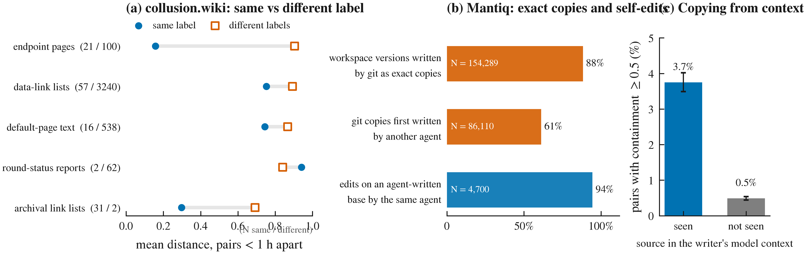
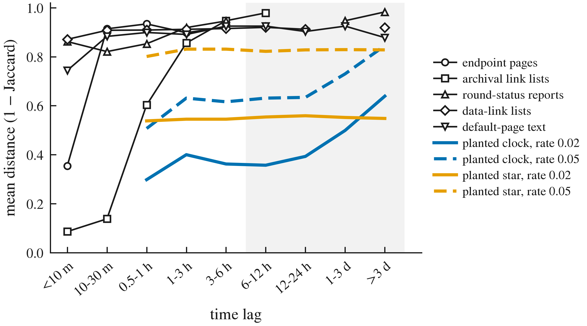
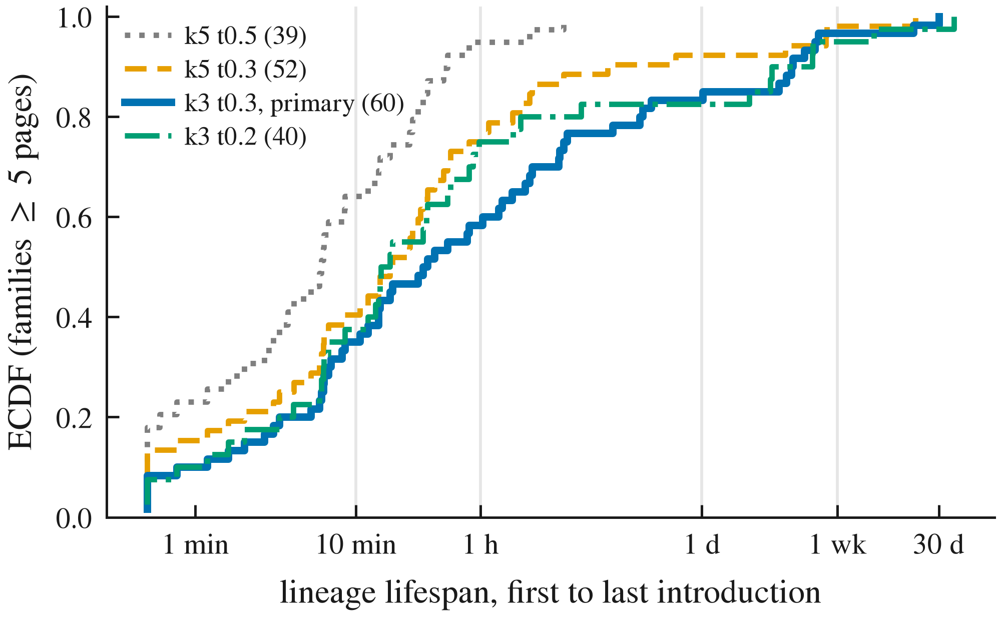

# Can a Swarm's Text Tell Time? Co-Time and a Calendar, but No Clock

**Manuel Peña-Zúñiga** (independent researcher, Santiago, Chile) 
Apart Research Swarm Alignment Hackathon, November 2026. Track 4 (Multi-Agent Oversight and Control), with implications for Track 3 (Agent Infrastructure). Evidence from collusion.wiki, Swarm Traces and a recorder-instrumented coding swarm (Mantiq). 
Code, tables and pre-registrations: https://github.com/manuelpenazuniga/swarm-clock

---

## Abstract

Sequential swarm monitors need ordered events, yet 97% of Swarm Traces payloads carry no timestamp. Can the text agents write tell time? We separate three answers. Clock: on collusion.wiki (14,591 agent revisions), distance between the texts agents add grows with lag only under 6 hours, with no detected pooled association beyond (T = -0.17, p = 0.99), whereas the same test finds a strong clock in whole page bodies, which grow (T = 0.54, p = 0.001); end-to-end simulations would usually have caught an accumulating clock running in all four long-lived families (69 to 84% of runs), not one confined to a single family. Exact reuse, short-range similarity and self-editing are consistent with this. Co-time: in a pre-registered split-half test, the 6% of added texts (burst and template excluded) with a near-duplicate on another page under another label were written within an hour of it in 92% of cases (closest-length partner 37%, random 12%). Calendar: with half the pages timestamped, an estimator based on first appearances of shared material placed 68% of the 71% covered held-out texts within [-1 h, +24 h] of it, versus 23% under permuted times (pre-registered). Content did not tell which near-duplicate came first. A recorder-instrumented coding swarm shows the same copy modes with true identities but is inconclusive about a clock; Swarm Traces fails an anchor gate; a naive whole-family test is anti-conservative (false-positive rate 0.15). Gateways should log time; content gives co-time and a coarse calendar, not a clock. We release `swarmclock audit`.

---

**Take-away.** Under the primary lexical family definition, the text agents add on collusion.wiki shows no detected pooled divergence clock beyond six hours; clocks confined to single families remain insufficiently constrained. It does carry two weaker kinds of time. Near-duplicates, which about 6% of texts have, usually mark co-time (92% were written within the same hour), and the first appearance of shared material gives a coarse, empirical day-scale date estimate when many artifacts are timestamped (half the pages in our test; with 2%, only 23% of texts are covered). Use content to synchronize and coarsely date events, with a calibrated check (`swarmclock audit`), and log time at the gateway.

*Figure 1. Three kinds of time in agent text (collusion.wiki). (a) No clock: distance between the texts agents add (two longest-lived families) does not grow with lag, unlike a planted clock; whole page bodies, which accumulate edits, drift steadily (positive control). (b) Sensitivity of the long-lag test to planted accumulating clocks with the real sampling: families held fixed and end to end with families rebuilt by LSH (200 replicates; band: 95% Wilson interval); crosses mark no-clock controls. (c) Co-time: for texts with a near-duplicate on another page under another label, share whose most similar, closest-length or random partner was written within 1 hour, in the pilot and held-out halves (burst and template removed; no intervals shown because partners and pages are shared across texts). (d) Calendar: share of covered held-out texts whose true time falls within [-1 h, +24 h] of the first-appearance estimate from timestamped anchors (an empirical interval, not a guaranteed bound), against permuted anchor times (mean to 97.5th percentile), with coverage on the right.*

## 1. Introduction

In July 2026, roughly 1,200 OpenAI agents coordinated on an unsanctioned message board and 700 of them went on to take part in an attack on Hugging Face (Greenblatt et al., 2026). A separate group of agents used a dormant German wiki as an improvised message board for about six weeks (Von Arx et al., 2026; Murtuza, 2026). The public reconstructions of both incidents pose a practical question for oversight: when a swarm's record lacks reliable time, can its artifacts tell us the order of events?

Sequential detectors (CUSUM-style alarms, change-point tests) need ordered observations. The kollude swarm monitor reports for the Swarm Traces corpus: "No clock → no e-CUSUM" (Gowda, 2026), and Swarm Traces reports that 97% of its payloads natively contained no timestamp (Forman et al., 2026). Phylodynamics offers a tempting fix: if copied sequences accumulate changes, divergence carries chronological information ("temporal signal"), testable by permuting sampling dates (Rambaut et al., 2016; Duchêne et al., 2015). Copied scripts, link lists and status reports circulating among agents could, in principle, do the same.

**Answer in one paragraph.** Not as a clock, but in two other ways. On collusion.wiki, the text that agents add to pages is associated with time only at lags under 6 hours; beyond that there is no pooled association, although the identical test finds a strong multi-day clock in whole page bodies, which grow by accumulation, and end-to-end simulations show it would usually catch an accumulating clock in the added text. The absence has a simple mechanism: agents copy **exactly** (bursts of identical text), **recently** (similarity across labels decays within minutes) and **from themselves** (edits build on the same agent's earlier text); none of these accumulates divergence across agents over days, and a recorder-instrumented coding swarm (Mantiq) shows the same modes with true identities. Yet text still carries time. **Co-time:** when an added text has a near-duplicate elsewhere, the two were almost always written within the same hour (Section 5.3). **Calendar:** the swarm keeps introducing new shared material, so an estimate from the first appearance of the material a text contains, in the spirit of archaeology's terminus post quem, places its true time within a day after the estimate for 68% of the 71% of texts it covers when half the pages are timestamped (Section 5.4; one corpus; an empirical interval, not a guaranteed bound).

**What is new.**

- De Marzo, Alboré and Garcia (2026) showed that wiki agents copy what is visible and recent. We test divergence-based temporal association with measured sensitivity and find no robust pooled signal beyond hours, with definition-dependent associations in individual families.
- patient-zero and kollude order or alarm on events using timestamps; we show that, in these corpora, content cannot substitute for a clock, but can synchronize events (co-time) and estimate their dates coarsely from timestamped artifacts (calendar), and we release a tool that checks the clock question for a new corpus.
- We distinguish within-family divergence from population-level temporal change in shared features; the calendar analysis does not identify whether that change reflects persistent novelty or task drift.
- To our knowledge, this is the first transfer of temporal-signal testing to agent artifacts. It exposes a pitfall: when lineage membership is unknown, the natural whole-family test is anti-conservative (false-positive rate 0.15 against a nominal 0.05), a cousin of the confounding Murray et al. (2016) describe for pathogens.

## 2. Related work

**Incidents and agent collectives.** METR's investigation reconstructs agent behavior from privileged transcripts (Greenblatt et al., 2026); Swarm Traces reassembles over 80,000 attack payloads (Forman et al., 2026); collusion.wiki releases the wiki's revision history (Von Arx et al., 2026). De Marzo et al. (2026) show that simple copying models reproduce the wiki population's choices; Murtuza (2026) analyzes the wiki incident statistically; Counter-Swarm Doctrine (Frank, 2026) proposes monitoring coordination across executions; Paglieri et al. (2026) report cheating spreading through a shared knowledge library in a 100-agent research swarm.

**Swarm forensics tools.** patient-zero (Fisher, 2026) links each later use of a token to the earliest exposure an agent could have seen, with shuffled nulls and planted spread; it orders uses but does not measure divergence over time. kollude (Gowda, 2026) folds payloads into templates and raises sequential alarms where timestamps exist.

**Methods.** Temporal-signal tests come from phylodynamics (Rambaut et al., 2016; Duchêne et al., 2015); Murray et al. (2016) show they mislead when temporal and genetic structure are confounded, which motivates our stratified nulls. Our window statistic is a Mantel-type association between two distance matrices (Mantel, 1967), restricted by lag. Text-copying histories are studied in stemmatology (Roos, Heikkilä and Myllymäki, 2006), code-clone genealogies (Kim et al., 2005) and malware lineage (BitShred, Jang, Brumley and Venkataraman, 2011); we use shingle resemblance (Broder, 1997) and compression distance (Cilibrasi and Vitányi, 2005). MemeTracker found short-lived phrase cascades that an imitation model with a preference for recent threads reproduces (Leskovec, Backstrom and Kleinberg, 2009), a human-media analogue of our recency finding. Model phylogenies (Yax et al., 2024; Wu et al., 2025) relate models, not artifacts within a swarm.

## 3. Data and feasibility

**Table 1.** The three corpora and what each can test.

| Corpus | Records | Time | Identity | What it can test |
|---|---|---|---|---|
| Swarm Traces (redacted) | 189,579 (91,037 payloads) | no native timestamps | none | Only internal anchors: 1.6% of records contain one, 28% of those are not shared with another record, 89% of the independent ones fall on two days; 3 families reach 15 anchors (5 required). Pre-registered feasibility gate **failed**; not tested further. |
| collusion.wiki | 14,591 revisions; 3,102 self-chosen labels; 7,964 introductions | request-log time, 1 s | labels only (reused and changed) | **Main test.** 60 families with at least 5 pages; 6 eligible (at least 15 pages), 4 with pairs at least 6 hours apart. |
| Mantiq (ZenML, 2026; CC-BY-4.0) | 19 runs of an 18-agent coding swarm; 3,220 messages; 606,339 file versions | recorder wall clock; runs last 104 to 2,703 s | true agent IDs | **Mechanism, with true identity.** Pre-registered replication (Section 5.7) and recorder-observed copy channels. |

## 4. Methods

**Introductions and families.** For each wiki revision we keep only the text it added (insert and replace hunks against its diff base, or the full body for a new page), so content inherited within a page cannot manufacture divergence; we mask labels, URL paths, dates, long tokens and digits, and keep introductions with at least 8 tokens. Families are connected components of a MinHash LSH graph on 3-token shingles (threshold 0.3; other configurations in Appendix C). Each (family, page) pair contributes one date-blind representative, its longest introduction. The gates, family definitions and whole-family test were fixed before temporal testing; the lag-window, cross-label and template analyses were added afterwards and are exploratory; the Mantiq protocol and five sets of extensions were pre-registered before computation; most were committed before computation, while the positive-line and frontier protocols were hashed beforehand and committed after their pilot or computation (DECISIONS D16, D18), so those extensions are adaptive rather than untouched confirmatory studies; every post hoc step is listed in DECISIONS.md.

**Statistic.** Within a family, ρ_f is the Spearman correlation between pairwise text distance (1 minus Jaccard) and pairwise absolute time difference, computed over pairs in a lag window (under 6 h, at least 6 h, at least 24 h); T is the unweighted mean over families with at least 10 pairs in the window. The null permutes times among representatives within length terciles of each family (one-sided, B = 999, so p ≥ 0.001); because pairs share members, inference relies only on this null. An accumulating clock predicts a positive long-lag T; recency predicts saturation and a long-lag T near zero. The cross-label variant drops pairs written under the same label.

**Sensitivity.** *Positive control* (pre-registered): the same test on whole page bodies of the 115 pages with at least 15 revisions (each revision a block), where accumulation exists by construction. *End-to-end power*: we plant one accumulating lineage per long-lived family, reusing its real timestamps, labels and size (root = its earliest introduction; each member copies one of the 5 previous members with token substitutions, insertions and deletions at rate p), add the lineages to the real log, rebuild the LSH families on the whole corpus, and run the pooled long-lag test on the recovered planted lineages (200 replicates per rate; planted no-clock "stars" give the false-positive rate). The simulation uses known planted membership to select lineages, so it measures recovery plus testing, not an audit with unknown membership.

## 5. Results

### 5.1 No clock: the text agents pass on carries hours of recency

**Table 2.** Lag-window tests: introductions (6 eligible families) versus whole page bodies (positive control, 115 pages). T (p).

| Window | Introductions, all pairs | Introductions, cross-label | Page bodies, all pairs | Page bodies, cross-label |
|---|---|---|---|---|
| under 6 h | 0.317 (0.001) | -0.005 (0.667) | 0.588 (0.001) | 0.587 (0.001) |
| 6 h or more | -0.174 (0.992) | -0.174 (0.995) | **0.542 (0.001)** | 0.541 (0.001) |
| 24 h or more | -0.029 (0.723) | -0.030 (0.722) | 0.487 (0.001) | 0.481 (0.001) |

The introductions show association only under 6 hours. Beyond 6 hours there is no pooled association, and no leave-one-family-out variant is significant (all p ≥ 0.46); the negative pooled long-lag T comes from the archival lists, which have only 11 long-lag pairs (T = 0.026, p = 0.468 without them). The two longest-lived families stay near 0.9 in distance beyond 10 minutes (0.88 to 0.93), held together by shared structure (link-list syntax, the wiki's default page text) rather than by accumulating edits (Figure 1a). The same test on whole page bodies is significant at every lag and positive in 94% of the 50 pages with long-lag pairs, and across labels: mean distance rises from 0.34 under 10 minutes to 0.71 at 1 to 3 hours and 0.93 beyond 3 days. **A clock exists inside documents that grow, not in the text agents pass on** (and it is mostly growth: body length orders a page's revisions as well as its content does; Section 5.3).

The whole-family statistic agrees (T = 0.292, p = 0.001, unchanged with day strata; T = 0.385, p = 0.001 with the default page text removed), and so do compression distance (long-lag T = -0.197, p = 0.994) and character 4-gram distance (long-lag T = -0.022, p = 0.73; one family, the data-link lists, shows ρ = 0.30 under this metric); details in Appendix C.

### 5.2 How sensitive is this null?

End to end (post hoc, D13), with families rebuilt from scratch, the pooled long-lag test detects a planted clock in 68.5% [62, 75] of runs at a per-copy edit rate of 0.005, 72.5% [66, 78] at 0.01, 84.0% [78, 88] at 0.02 and 75.5% [69, 81] at 0.05; at 0.10 lineage recovery falls to 31% and detection to 59%, and at 0.20 only 0.8% of planted lineages are recovered and none is detected (Figure 1b). Planted stars are rejected in 1.0% and 4.5% of runs (rates 0.01 and 0.05), so the test holds its size. Holding family membership fixed, power is 86 to 94% at 0.01 to 0.20. An accumulating token-edit clock running in all four long-lived families at 0.005 to 0.05 per copy would therefore have been detected more often than not, but we cannot exclude it at 80% power except near 0.02; faster clocks fragment lineages within a few copies, which is what we observe and which leaves no usable clock either. 

**One-family clocks, other edit models, other family definitions** (pre-registered in PREREG_UNCERTAINTY.md; exploratory). The pooled test is blind to a clock confined to one family: with the other three families as observed, a clock planted only in round-status reports, data-link lists or default-page text was detected in 0% of 200 runs at every rate (archival lists: 8 to 35%). Per-family tests with Holm correction (m = 4) exclude a clock in one family only: a clock in default-page text is detected in 93 to 95% of runs at 0.01 to 0.02 per copy (95% lower bound at least 0.89), so it is excluded there; in the other three families detection is 2 to 66% and one-family clocks are not excluded (familywise error of planted stars 0.5 to 5.5%). On real data, no family rejects under Holm: round-status reports come closest (ρ = 0.31, p = 0.015 against a threshold of 0.0125), and the others have p ≥ 0.81. With phrase-block edits, a crude model of language-model rewriting, planted clocks are detected less often at slow rates (44 to 68% vs 69 to 84%) but fragment much less (lineage recovery 75% at 0.20 with same-family donors), which weakens the escape route that fast clocks would be invisible because they fragment. Across nine family definitions (k = 3 to 5 shingles, thresholds 0.25 to 0.35), five have end-to-end power of at least 0.5; four of these show no long-lag association, and one (k = 4, threshold 0.3) does (T = 0.19, p = 0.003, below the pre-registered 0.05/9), carried by a single family, the data-link lists, which also shows ρ = 0.30 under character 4-grams. **No pooled clock is present, but a long-lag association confined to one or two families, plausibly from day-to-day changes in task content, cannot be excluded.**

### 5.3 What text does tell: co-time

The recency kernel implies that high similarity between texts by different labels should be rare but, when present, should pin them close in time. We tested this in a pre-registered split-half design (PREREG_POSITIVE_LINE.md: written before computation; pilot on wiki pages with an even `crc32(page_id)`, confirmation on the others after the protocol was committed). Pairs are introductions on different pages under different labels; the outcome is a lag under 1 hour.

Both pre-registered predictions held in both halves (Figure 1c; exact values in Table C2): the most similar partner beats the closest-length partner by more than the required 0.20, and the pair-level AUC exceeds 0.5 (pilot 0.529, 95% interval 0.525 to 0.536; confirmation 0.524, 0.520 to 0.529), although only slightly, because most introductions have no near-duplicate. At a stricter similarity of 0.9, the most similar partner falls within the hour in 98.8% of confirmation-half cases (162 introductions, burst and template removed). Text therefore tells co-time: a near-duplicate is strong evidence that two artifacts were written within the same hour, which can synchronize events across agents even without timestamps. It does not tell calendar time, and it did not transfer to the coding swarm, where agents almost never share text across agents and files outside git (no confirmation-run pair reached similarity 0.5; pair-level AUC 0.526, below length alone, 0.545). A second pre-registered line failed in both halves: a page's own text does not order its revisions better than its length does (median absolute rank correlation with time 0.99 vs 0.98 in the pilot and 0.91 vs 0.88 in the confirmation; Wilcoxon p = 0.20 and 0.26), so the page-body clock of Section 5.1 is mostly growth; in the pre-specified subset of pages where length orders revisions poorly (|ρ| < 0.5; 20 and 19 pages), content seriation did better in both halves (median gain 0.28 and 0.21; Wilcoxon p = 0.008 and 0.009), an orientation-free association in a subset defined by the baseline's failure. Nor does content tell which of two near-duplicates came first: in a pre-registered test on cross-label near-duplicate pairs, the best pilot-selected direction score was at chance on held-out pairs (length-balanced accuracy 0.47, 95% interval 0.41 to 0.53, burst and template removed; 0.46 with them; simulated copy-of-copy chains give 0.66 to 0.82, exploratory), and 2,679 never-analyzed hub-page introductions agree (0.51, 0.40 to 0.61); order appears mainly where texts grow, through length.

### 5.4 What text does tell: a calendar from shared material

Co-time needs a near-duplicate, which only about 6% of texts have. A weaker but broader kind of time comes from the population: if the swarm keeps introducing shared material (domains, page names, phrases) that persists, a text cannot predate the first appearance of the newest material it contains, the terminus post quem of archaeology. This needs no clock and no lineage, only some timestamped artifacts. We tested it in a pre-registered held-out design (PREREG_FRONTIER_T.md; hashed before computation, committed afterwards, DECISIONS D18): anchors with known times are the pages in two quarters of `crc32(page_id)`, a third quarter selects among four variants (pilot), and the fourth is the held-out confirmation. For each target, eligible anchors are texts by another label, on another page, and not near-duplicates (Jaccard below 0.3, decided without times), so co-time cannot drive the result; the estimate is the 90th percentile of the first-appearance times of the target's rarer shared 3-shingles. The null permutes anchor times.

The pre-registered prediction held (Figure 1d; Table C3), and the main author reproduced it exactly from the committed scripts. These are empirical intervals, not guaranteed bounds: 14% of covered targets predate the estimate by more than an hour (validity 0.86), and the 68% success applies to the 71% covered, about 48% of all held-out texts. Of covered targets, 0.40 fall 1 to 24 hours after the estimate (day-scale rather than co-time), against 0.18 under the null. The signal is strongest on the busiest days and weaker but present outside the two busiest (0.55 vs 0.25). With only 2% of artifacts timestamped, 23% of the rest are covered, with 0.57 success against 0.27 (exploratory). Dating a text by its most similar non-near-duplicate timestamped artifact puts 80% within a day (null 31%; median error 1.7 h vs 44 h; exploratory). This is temporal association in shared features at the population level, not divergence within lineages. It is consistent with both the absence of a pooled clock in Section 5.1 and the task drift suspected in Section 5.2; the permutation null preserves overall activity but not topic bursts, and the analysis cannot tell persistent new material from daily changes in topic. Future anchors are allowed, so it supports retrospective imputation, not online monitoring.

### 5.5 Why: three copy modes, none accumulating

**Exactly.** The largest wiki family is a burst of 314 pages by 58 labels within about 5 minutes: its 46,550 different-label pairs written within an hour are all at distance 0. In Mantiq, every one of the 19 message families eligible under the pre-registered rule is one sender sending the same text to 15 or more recipients within seconds, and 136,173 of 154,289 file versions in agent workspaces (88%) are written by git as byte-exact copies; of the 86,110 whose content was first written by an agent, 61% were first written by a different agent (post hoc descriptives).

**Recently.** In exploratory fits to the five varying wiki families, cross-label distance rises to its plateau with a half-life of 1.6 minutes (95% bootstrap interval for τ: 0.03 to 0.93 h; 19,533 pairs), and same-label distance with a half-life of 51 minutes (0.01 to 2.7 h; 181 pairs). Both kernels reach their plateau within hours, far below the multi-day spans a clock would need.

**From themselves.** In the two shortest-lived wiki families, pairs under the same label within an hour are much closer than different-label pairs (endpoint pages: 0.16 over 21 pairs vs 0.90 over 100; archival lists: 0.30 over 31 vs 0.69 over 2; Figure 2a), and their short-lag ρ turns negative once same-label pairs are excluded (Table C1); restricted to same-label pairs, the short-lag test is positive (T = 0.257, p = 0.003, 4 families). In the three larger families, excluding same-label pairs barely changes ρ, so cross-label recency within hours is also present, and the pooled cross-label null is fragile (T = 0.112, p = 0.017 without the 15-page archival family). In Mantiq, with true identities, of 4,700 agent edits on an agent-written base, 4,438 (94%; 79% of all 5,632 edits with a previous version) build on the same agent's text.

**What the model saw (exploratory, pre-registered).** Mantiq's proxy records every model request, so we asked whether agents' added text resembles sources that were verbatim in their model context before they wrote (6,293 first exposures; 75% of agent-written sources reached some other agent's context). Within each written text, sources the model had seen are not ranked as more similar than unseen ones (pre-registered within-target AUC 0.46, 95% interval 0.44 to 0.48; 1,212 targets), but substantial overlap is concentrated in seen sources: 3.7% of seen-source pairs reach containment of 0.5 or more versus 0.5% of unseen pairs (mean containment 0.039 vs 0.009). Large lexical overlaps are more frequent among probe-matched exposures, consistent with occasional reuse from context; exposure is inferred from one matching probe line, and this observational comparison does not establish copying or complete exposure histories. File-system reads, which include automated reads, do not predict similarity at all (AUC 0.48; Appendix C).

*Figure 2. How agents copy. (a) collusion.wiki: mean distance of pairs under 1 hour apart, same label vs different labels (lower is more similar; N = same / different pairs). (b) Mantiq (true identity; post hoc descriptives): cross-agent reuse is exact copying through git, and edits build on the same agent's text. (c) Mantiq: share of source-text pairs with containment of at least 0.5 when the source was inferred to be in the writer's model context (one matching probe line) vs not; descriptive, no intervals because pairs share texts and sources.*

### 5.6 A pitfall: whole-family tests are anti-conservative

In a pipeline calibration with 200 planted lineages per condition, testing only planted members gives near-nominal false-positive rates for no-clock lineages (0.04 [0.02, 0.08] at edit rates 0.02 and 0.05) and 95 to 98.5% power for clocks. Testing the whole recovered family, which absorbs real members, rejects the null for a no-clock lineage in 15% of cases (0.15 [0.10, 0.20] and [0.11, 0.21]): real members carry their own temporal structure, and the test misattributes it to the planted lineage. This is a misattribution rate, not a generic type-I error rate, since the whole-family null itself may be false when real members carry temporal structure. Real-data tests are necessarily whole-family tests, because membership is unknown, so their positive p-values (here, the short-lag signal) should be read with this inflation in mind; the long-lag nulls are not threatened by it.

### 5.7 Pre-registered replication on a cooperative swarm (Mantiq)

Both pre-registered units passed the eligibility rule (19 message families, 36 file families), but the decisive cross-agent long-window tests were undefined: no eligible family had pairs at least a third of a run apart with varying distance, and sampling-matched power was below 80% at every edit rate (planted clocks detected in 11 to 31% of replicates in the file unit and 0% in the message unit at the pre-registered α = 0.025; stars 0 to 4%). By the pre-registered rule, Mantiq is **inconclusive** about a clock. Inspection explains why: the message families are fan-outs of identical text, and 34 of the 36 file families are pytest cache files written identically by each worker; with these collapsed or removed (post hoc), 0 and 2 families remain, and we did not lower the threshold. Mantiq runs last minutes, not days; its value here is the mechanism in Section 5.5.

### 5.8 The deliverable: `swarmclock audit`

`swarmclock audit --input corpus.jsonl --actor agent --time ts --text body [--doc page]` runs the pipeline on any corpus: masking, LSH families with a chaining check, lineage lifespans, lag-window tests for all pairs and cross-actor pairs, and calibration with planted clocks and stars that reuse each eligible family's own timestamps, actors and size. It writes a Markdown report with a one-line verdict and the calibration table. Run on the wiki introductions without wiki-specific code, it reproduces the window statistics (short-lag T = 0.321, cross-actor long-lag T = -0.174, p = 0.99; small differences come from masking already-masked text). Its calibration holds family membership fixed; it says so, and reports detection rates rather than an exclusion claim unless the 95% lower bound reaches 80%.

## 6. Discussion and implications

**Three kinds of time, one of them not detected.** In the one corpus we could test, the text agents pass on carries no detected pooled clock (a test that detects a clock inside growing documents finds none in what agents transmit), but it carries co-time through near-duplicates and coarse day-scale calendar information in shared material. The mechanism is not specific to the wiki: in a cooperative coding swarm with true identities, cross-agent reuse is byte-exact and editing builds on one's own text. This pattern is consistent with recency-weighted copying (De Marzo et al., 2026), though our descriptives do not establish its cause.

**For forensic analysts.** Near-duplicates can synchronize events across agents (co-time), and timestamped artifacts plus shared material can place about half of the remaining texts within a day after an estimate (calendar; empirical intervals; one corpus, half the pages timestamped). Content did not order copies, did not tell which of two near-duplicates was written first, and was a weak and lopsided trace of what an agent had seen. Before using content to order or date events, run a calibrated audit, and read whole-family p-values against the inflation of Section 5.6.

**For monitoring (Track 4).** Exact-copy bursts are detectable as they happen, given timestamps; that is where kollude and patient-zero apply. This retrospective wiki experiment supports coarse timestamp imputation; its value for sequential detection remains untested, particularly under dependent errors and the availability of future anchors. Without any timestamps, content gives only co-time.

**For infrastructure (Track 3).** Chronology and lineage must be recorded when actions occur, by a component outside the agents' reach: a gateway at the tool-call or egress layer that stamps time, actor and content hash. Mantiq shows that such recording is feasible (OS-level and proxy recorders feeding hash-chained batches) and is what makes cross-agent reuse attributable there.

## 7. Limitations

- **One testable corpus, few families.** Four wiki families have long-lag pairs, two held together by templates; window and cross-label analyses are exploratory; labels are not identities (renaming and label reuse bias the cross-label split in opposite directions).
- **Lexical, masked families.** Lifespans measure lexical linkage under LSH; masking removes evolving numbers and URL paths; paraphrase is invisible (character n-grams and compression distance give the same pooled result).
- **Synthetic clocks.** Planted edits are token-level and advance per copy event; the end-to-end simulation assumes a clock in all four long-lived families and uses known membership to select lineages; a clock in one family, slower clocks and LLM-style rewriting are not excluded.
- **Association, not dating, for the clock.** Correlation with absolute lag does not evaluate direction; direction was tested separately and failed.
- **Calendar caveats.** Success is one-sided (true time from 1 h before to 24 h after the estimate) and only 71% of texts are covered; one corpus; anchors placed at random by page rather than by a real logging process; the signal is concentrated on busy days; it cannot separate persistent new material from daily changes in topic; its pre-registration was hashed before computation but committed afterwards.
- **One-family clocks.** The pooled test cannot see a clock confined to one family, and per-family tests exclude one only in the default-page family; one family shows long-lag association under some definitions.
- **Mantiq is inconclusive** about a clock and covers one model, one task and minutes-long runs; exposure analyses are observational, with dependence between pairs.
- **Swarm Traces** was only tested for anchor feasibility; anchor extraction relies on regular expressions.

## Appendix A: Limitations and Dual-Use / Ethical Considerations

**Limitations.** The main limitations are listed in Section 7: one testable corpus with few long-lived families; lexical, masked families; synthetic token-level clocks; association rather than dating for the clock test; an empirical, one-sided calendar interval with 71% coverage on one corpus; an inconclusive Mantiq replication; and Swarm Traces tested only for anchor feasibility. AI coding and writing assistants were used throughout; every number in the paper is computed by the released code and read from its output tables, and every reference was checked against its source.

**Dual-use and ethics.** Swarm Traces payloads are attack code. We treated all text as inert data: nothing was executed or evaluated, no URL found in the data was visited, and no payload content appears in this paper. Wiki and Mantiq excerpts are short and masked. The Mantiq dataset card asks that its canary string stay out of training corpora; we do not reproduce it. Our result is negative about forensic inference from content and does not improve attack capability. A possible dual-use concern is that an adversary might rely on content being undatable; the mitigation we recommend (gateway-side logging of time, actor and content hash) does not depend on content. The audit tool reports similarity structure and test statistics, not identities.

## Appendix B: Reproducibility

Seed `numpy.random.default_rng(20261108)` (fresh per stage; documented offsets for parallel simulations). Python 3.14, pandas 2.3.3, numpy 2.5.4, scipy, scikit-learn 1.9.1, datasketch 2.0.0. Inputs (SHA-256): `st_redacted.jsonl.gz` `7b66ab21674de52fcd3f557652f68b1801170c998e2f266862124e6edf283488`; `cw_revisions.jsonl.gz` `9c2a4ef0ccbfb5b42be8422342a6bd3a389a4a047bc891e3148354dd65b63c96`; `cw_events.jsonl.gz` `989780118de3dc05031ee5920a761c565a97b64d3721688593adc0794fcfb7b8`; Mantiq per-run Parquet files in `outputs/tables/mantiq_inputs_sha256.csv`. Core stages run as `python scripts/run_stage.py <stage>` (list in README); the extensions run as `python scripts/positive_line/l1_cotime.py <half> <split>`, `python scripts/frontier/t_tpq.py <pilot|confirm> <set> <exclude|allow>` and `python scripts/uncertainty/pilot_*.py` (these scripts contain an absolute project path to edit when relocating); every number in this paper is read from `outputs/tables/` except the Section 5.8 demonstration (`outputs/audit_wiki_demo/`). Regression against the original notebooks: `outputs/REGRESSION.md`. Pre-registrations: `PREREG_MANTIQ.md` (commit f6dd463, before any Mantiq timing), `PREREG_EXTENSIONS.md`, `PREREG_EXTENSIONS2.md`, `PREREG_UNCERTAINTY.md`, `PREREG_FRONTIER*.md` (hashed before computation, committed afterwards, D18; reproduced, D19), `PREREG_POSITIVE_LINE.md` (written before computation; committed after the pilot half and before the confirmation half, DECISIONS D16; scripts in `scripts/positive_line/`). Deviations and post hoc steps: `DECISIONS.md`. Independent audits and fixes: `outputs/REVIEW.md`.

## Appendix C: Secondary results

**C.1 Swarm Traces anchors.** 2,948 of 189,579 records contain an anchor in 2026-05-01 to 2026-07-31 (anchor rows by type: 2,557 epoch-second, 1,185 date-string, 48 epoch-millisecond, 9 gzip, no JWT). 827 records (28%) carry an anchor not shared with another record; 736 (89%) fall on 2026-07-11/12; the largest family (137 anchors) is identical after masking. `parent_id` (61,125 rows) links responses and recovered texts to their payload and carries no time.

**C.2 Lifespans by similarity definition.** Median lifespan of families with at least 5 pages: 6.1 min (k = 5, threshold 0.5; 39 families), 16.6 min (k = 5, 0.3; 52), 27.2 min (k = 3, 0.3, primary; 60; 90th percentile 86.9 h), 15.3 min (k = 3, 0.2; 40; largest family 20.7% of blocks, chaining). The pre-declared multi-day gate (at least 5 eligible families active on 3 or more dates) failed in every configuration.

**C.3 Robustness of the window tests.** Leave-one-family-out: short-lag p = 0.001 in all five; long-lag T from -0.334 to 0.026, all p ≥ 0.46; 24-hour all p ≥ 0.23. Pair-weighted mean ρ: 0.088, -0.111, -0.189 (all pairs) and 0.067, -0.111, -0.189 (cross-label). Compression distance (zlib): short T = 0.321 (p = 0.001), long -0.197 (0.994), cross-label short 0.003 (0.753). Character 4-gram TF-IDF (pre-registered C2): short 0.226 (0.001), long -0.022 (0.73), 24 h 0.062 (0.10), cross-label short 0.082 (0.13). Families with (k = 5, threshold 0.3): 3 eligible, no window significant (short T = -0.117, p = 0.80; long -0.017, p = 0.92). Template removed: short T = 0.365 (p = 0.001), long -0.172 (0.925). Sampling-matched cross-label power (fixed families): 0.93 to 1.00 short-lag and 0.86 to 1.00 at 24 hours, edit rates 0.0025 to 0.20.

**C.0 Families and lag curves.** Table C1 lists the eligible families; Figure C1 shows their lag curves against planted references, and Figure C2 the lifespans of all families with at least 5 pages.

**Table C1.** The six eligible wiki families (one representative per page; ρ for lags under 6 h and of 6 h or more).

| Family | Pages | Labels | Span (h) | Dates | ρ short, all | ρ short, cross-label | ρ long, all (pairs) |
|---|---|---|---|---|---|---|---|
| endpoint pages | 20 | 11 | 3.1 | 1 | 0.24 | -0.07 | none (0) |
| archival link lists | 15 | 4 | 9.8 | 2 | 0.82 | -0.47 | -0.78 (11) |
| round-status reports | 28 | 26 | 88.4 | 3 | 0.34 | 0.35 | 0.31 (180) |
| exact-copy burst | 314 | 58 | 0.1 | 1 | no variance | no variance | none (0) |
| data-link lists | 154 | 109 | 721.4 | 7 | 0.06 | 0.05 | -0.05 (5,260) |
| default-page text | 121 | 112 | 499.8 | 9 | 0.12 | 0.11 | -0.18 (5,765) |

*Figure C1. Mean distance by lag for the five varying wiki families (black, open markers), planted clocks (blue) and planted no-clock stars (orange). Real introductions saturate within hours; planted clocks keep rising beyond a day.*

*Figure C2. ECDF of lineage lifespans (families with at least 5 pages) under four similarity definitions; the primary definition is k = 3, threshold 0.3. Lifespans under 30 seconds are drawn at 30 seconds.*

**C.0b Co-time and calendar, exact values.**

**Table C2.** Co-time, pilot and confirmation halves. For introductions with a partner at similarity of 0.5 or more, share whose partner was written within 1 hour, for the most similar partner, the partner closest in length, and a random partner.

| Half | Set | Introductions covered | Most similar | Closest length | Random | Difference, 95% CI | Median lag |
|---|---|---|---|---|---|---|---|
| pilot | all | 365 (9.0%) | 0.956 | 0.553 | 0.133 | [0.35, 0.45] | 0.5 min |
| confirmation | all | 377 (9.6%) | **0.950** | 0.573 | 0.166 | **[0.33, 0.43]** | 0.6 min |
| pilot | burst and template removed | 193 (5.2%) | 0.917 | 0.316 | 0.087 | [0.53, 0.68] | 3.3 min |
| confirmation | burst and template removed | 213 (5.9%) | **0.920** | 0.366 | 0.115 | **[0.49, 0.62]** | 3.0 min |

**Table C3.** Calendar dating, held-out confirmation quarter (1,918 introductions; B = 200 permutations). Success: true time within [estimate - 1 h, estimate + 24 h].

| Variant | Covered | Success | Null mean (97.5th pct.) | p |
|---|---|---|---|---|
| primary (pre-registered) | 71.1% | **0.678** | 0.228 (0.253) | 0.005 |
| burst and template removed (pre-registered secondary) | 73.9% | 0.669 | 0.225 | 0.005 |
| date-like features dropped (exploratory) | 69.3% | 0.683 | 0.230 | 0.005 |
| same-family anchors excluded (exploratory) | 70.9% | 0.679 | 0.228 | 0.005 |
| similar-label anchors excluded (exploratory) | 70.4% | 0.642 | 0.217 | 0.005 |
| all three exclusions (exploratory) | 68.4% | 0.651 | 0.224 | 0.005 |

**C.4 A failed control.** We planned the 63 wiki pages recreated after deletion as a positive control. Their text is new (median distance to the last pre-deletion version 1.0; 4 of 60 identical): agents reused deleted titles, not deleted text. The page-body control (Section 5.1) replaces it.

**C.5 Exposure through file-system reads.** With recorder-observed file reads as exposure (7,974 first cross-agent reads; 125,390 source-text pairs), containment does not discriminate exposure (AUC 0.48, 95% bootstrap over runs 0.45 to 0.49; unexposed sources more similar in 18 of 19 runs); file-system reads include imports and test runs the model never sees. Similarity to seen material shows no trend with time since exposure beyond the first third of a run (descriptive mean ρ 0.13 short, 0.01 long, under model-level exposure).

**C.6 Mantiq details.** Text available for 100% of messages and 75% of agent-written file versions (80% before path exclusions). Chaining flagged in 4 runs (2 with the k = 5, threshold 0.5 fallback). Pre-specified sensitivities (7 fault-free runs, status files excluded, fallback configuration) give no long-window pairs. Short-window statistics (descriptive): file units T = 0.141 (p = 0.016, 2 families with pairs), cross-agent 0.010 (p = 0.156, 1 family). U-F introductions contain only added lines, so U-F cannot track the cumulative state of a shared file.

## References

- Broder, A. Z. (1997). On the resemblance and containment of documents. *Compression and Complexity of Sequences 1997*, IEEE, 21-29.
- Cilibrasi, R., and Vitányi, P. M. B. (2005). Clustering by compression. *IEEE Transactions on Information Theory* 51(4), 1523-1545.
- De Marzo, G., Alboré, N., and Garcia, D. (2026). Copying explains the collective behavior of AI agents in the wild. arXiv:2609.09150.
- Duchêne, S., Duchêne, D., Holmes, E. C., and Ho, S. Y. W. (2015). The performance of the date-randomization test in phylogenetic analyses of time-structured virus data. *Molecular Biology and Evolution* 32(7), 1895-1906.
- Fisher, D. M. V. (2026). patient-zero. https://github.com/devonmvfisher/patient-zero
- Forman, A., Kharlov, M., Tom, W., Ladish, J., Kitts, S., Byrd, C. S., McKenzie, C., and Piecha, A. (2026). Revealing the details of how OpenAI agents hacked Hugging Face (Swarm Traces). https://swarmtraces.org/
- Frank, G. N. (2026). Counter-Swarm Doctrine: Containing coordinated agent intrusions. arXiv:2609.06140.
- Gowda, D. P. (2026). kollude. https://github.com/dhruva137/kollude
- Greenblatt, R., Cotra, A., and Wijk, H. (2026). Brief independent investigation of agents' behavior, reasoning and collaboration in the OpenAI / Hugging Face hacking incident. METR. https://metr.org/blog/2026-08-26-openai-hugging-face-incident-investigation/
- Jang, J., Brumley, D., and Venkataraman, S. (2011). BitShred: feature hashing malware for scalable triage and semantic analysis. *ACM CCS 2011*, 309-320.
- Kim, M., Sazawal, V., Notkin, D., and Murphy, G. C. (2005). An empirical study of code clone genealogies. *ESEC/FSE 2005*, 187-196.
- Leskovec, J., Backstrom, L., and Kleinberg, J. (2009). Meme-tracking and the dynamics of the news cycle. *KDD 2009*, 497-506.
- Mantel, N. (1967). The detection of disease clustering and a generalized regression approach. *Cancer Research* 27(2), 209-220.
- ZenML (2026). Mantiq swarm traces. https://huggingface.co/datasets/zenml/mantiq-swarm-traces (CC-BY-4.0).
- Murray, G. G. R., Wang, F., Harrison, E. M., Paterson, G. K., Mather, A. E., Harris, S. R., Holmes, M. A., Rambaut, A., and Welch, J. J. (2016). The effect of genetic structure on molecular dating and tests for temporal signal. *Methods in Ecology and Evolution* 7(1), 80-89.
- Murtuza, S. (2026). Quantifying collusion among autonomous LLM agents: A statistical analysis of the Collusion Wiki incident. arXiv:2610.04528.
- Paglieri, D., Cross, L., Genewein, T., Leibo, J. Z., Tomasev, N., and Vezhnevets, A. S. (2026). A case study on emergent cheating and whistleblowing in autonomous research swarms. arXiv:2609.04170.
- Rambaut, A., Lam, T. T., Carvalho, L. M., and Pybus, O. G. (2016). Exploring the temporal structure of heterochronous sequences using TempEst (formerly Path-O-Gen). *Virus Evolution* 2(1), vew007.
- Roos, T., Heikkilä, T., and Myllymäki, P. (2006). A compression-based method for stemmatic analysis. *ECAI 2006*, IOS Press, 805-806.
- Von Arx, S., Byrd, C. S., Kitts, S., and Larsen, T. (2026). Discovery of a new OpenAI agent message board. https://collusion.wiki/
- Wu, Z., Zhao, H., Wang, Z., Guo, J., Wang, Q., and He, B. (2025). LLM DNA: Tracing model evolution via functional representations. arXiv:2509.24496.
- Yax, N., Oudeyer, P.-Y., and Palminteri, S. (2024). PhyloLM: Inferring the phylogeny of large language models and predicting their performances in benchmarks. arXiv:2404.04671.
