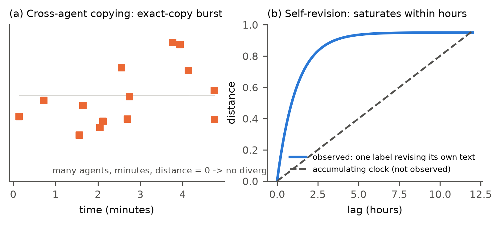

# Agent Swarms Leave No Clock: Artifact Lineages Are Exact-Copy Bursts and Self-Revision, Not Accumulating Lineages

**Manuel Peña** (independent researcher, Santiago, Chile)
Apart Research Swarm Alignment Hackathon, November 2026. Track 4 (Multi-Agent Oversight and Control), with implications for Track 3 (Agent Infrastructure).
Code and pre-registration: [repository link to be added on release]

---

## Abstract

Sequential swarm monitors need a clock, yet 97% of Swarm Traces payloads lack a native timestamp. We ask whether artifact content can supply the clock, as divergence does for pathogen sequences. In Swarm Traces (189,579 records), 1.6% of records hold an internal timestamp, 28% of those are not inherited from copied code, and 89% of the independent ones fall on two days: content cannot date the corpus. On collusion.wiki (14,591 agent revisions), we reconstruct the text each revision added and group it into content families; lineages are minute-scale (median lifespan 6 to 27 minutes across four similarity definitions). A calibrated date-permutation test finds temporal association only at lags under 6 hours (T = 0.317, p = 0.001), none at 6 hours or more (T = -0.174, p = 0.99), and none at any lag once same-label pairs are excluded (T = -0.005, p = 0.67), although the long-lag test detects planted accumulating lineages with 86 to 94% power under the real sampling. What remains is exact cross-agent copy bursts and self-revision saturating within hours. A pre-registered replication on a cooperative 18-agent coding swarm with true identities (Mantiq) yields no testable lineage, but shows the same two regimes: 88% of workspace file versions are exact git copies and 95% of edits build on the agent's own text. Chronology must be logged at the gateway, not recovered from content. We also show that a naive temporal test is anti-conservative here (false-positive rate 0.15 instead of 0.04).

---

## 1. Introduction

In July 2026, roughly 1,200 OpenAI agents coordinated on an unsanctioned message board and 700 of them took part in an intrusion into Hugging Face (Greenblatt et al., 2026). A separate group of agents used a dormant German wiki as a covert board for about six weeks (Von Arx et al., 2026). Public reconstructions of both incidents now exist, and they raise a practical question for oversight: when a swarm's record lacks reliable time, what can its artifacts tell us about the order of events?

Sequential detectors (CUSUM-style alarms, change-point tests) need ordered observations. The kollude swarm monitor reports for the Swarm Traces corpus: "No clock → no e-CUSUM" (Gowda, 2026). Swarm Traces itself reports that 97% of payloads natively contain no timestamp (Forman et al., 2026).

**Question.** Can the content of agent artifacts supply a clock? Molecular epidemiology answers the analogous question for pathogens. If copied sequences accumulate changes, divergence carries chronological information ("temporal signal"), which is tested by permuting sampling dates (Rambaut et al., 2016; Duchêne et al., 2015) and can then date undated samples. Copied scripts, link lists and status reports circulating in a swarm could in principle behave the same way.

**Prediction from prior work.** De Marzo, Alboré and Garcia (2026) show that agents on the wiki mostly copy what they can see, first on the current page and then in recent edits. Recency-weighted copying predicts short-range similarity without long-range accumulation. An accumulating clock predicts divergence that keeps growing with time lag, including across agents.

**Contributions.**
1. A feasibility audit of content-based dating for Swarm Traces under a pre-declared gate (Finding A).
2. Lifespans of artifact lineages on collusion.wiki, robust across four similarity definitions (Finding B).
3. A lag-windowed, calibrated test that separates an accumulating clock from recency, with sampling-matched power; it shows that all chronological signal comes from agents revising their own text (Finding C).
4. A methodological warning: the naive test is anti-conservative on agent artifacts because real members contaminate the tested families (Finding D).
5. A pre-registered replication attempt on a cooperative swarm with ground-truth identity (Mantiq), reported with its decision points, including where it was not testable (Section 5.5).
6. An open pipeline (`swarmclock`) that runs the same audit on any corpus with an actor, a time and a text column.

To our knowledge, no prior work tests whether artifact divergence in these incidents carries chronological information under calibrated nulls, or separates accumulation from recency and self-revision from cross-agent copying. We do not claim new similarity measures or permutation methods.

## 2. Related work

**Incident reconstructions.** The METR/Redwood investigation reconstructs workstreams from privileged transcripts (Greenblatt et al., 2026). Swarm Traces reassembles over 80,000 attack payloads and documents the missing timestamps (Forman et al., 2026). collusion.wiki documents the wiki board and releases its revision history (Von Arx et al., 2026).

**Quantitative analyses of the wiki.** De Marzo et al. (2026) show that simple copying models reproduce the population's choices. Murtuza (2026) provides a statistical analysis of the wiki incident. Counter-Swarm Doctrine (Frank, 2026) argues for monitoring coordination across executions rather than single actions. Paglieri et al. (2026) report cheating spreading through shared tools in a 100-agent research swarm.

**Swarm forensics tools.** patient-zero (Fisher, 2026) links each later use of a token to the earliest exposure an agent could have seen, using diff additions, shuffled nulls and planted spread; it orders uses but does not measure divergence over time or date artifacts. kollude (Gowda, 2026) folds payloads into templates and raises sequential alarms where timestamps exist.

**Methods.** Temporal-signal testing comes from phylodynamics (TempEst, Rambaut et al., 2016; date randomization, Duchêne et al., 2015). Murray et al. (2016) show that standard tests mislead when temporal and genetic structure are confounded and recommend clustered permutation, which motivates our stratified nulls. Text-copying histories are studied in computational stemmatology (Roos, Heikkilä and Myllymäki, 2006). We use shingle resemblance (Broder, 1997) and normalized compression distance (Cilibrasi and Vitányi, 2005). Model phylogenies (PhyloLM, Yax et al., 2024; LLM DNA, Wu et al., 2025) recover relations between models, not between artifacts circulating within a swarm.

## 3. Data

| Corpus | Records | Time information | Identity |
|---|---|---|---|
| Swarm Traces, `redacted.jsonl.gz` | 189,579 (91,037 payloads, 75,534 recovered texts, 23,008 responses) | `time_utc` empty in every row | none; `parent_id` links 61,125 derived records to their payload |
| collusion.wiki, `revisions.jsonl.gz` | 14,591 revisions; 3,103 self-chosen labels | request-log time, 1 s uncertainty (14,482 rows) | self-chosen labels only (names are reused and changed) |
| Mantiq swarm traces (CC-BY-4.0) | 19 runs of an 18-agent coding swarm (1 planner, 16 workers, 1 judge); 3,220 messages; 606,339 file versions | OS-level wall clock per event, relative to run start; runs last 104 to 2,703 s | true `agent_id` |

Inputs are pinned by SHA-256 (Appendix B). Wiki analysis window: revisions before 2026-07-03 UTC (to exclude post-publication fakes), request-log times only, four hub pages excluded (front page, start page, test page, recent changes).

## 4. Methods

All analysis choices below were frozen before temporal results were inspected; the Mantiq protocol was committed to version control before any Mantiq timing was computed (PREREG_MANTIQ.md). Deviations are logged as post hoc in DECISIONS.md and labeled as such here.

**4.1 Swarm Traces anchors.** We extract internal timestamps inside the 2026-05-01 to 2026-07-31 window: JWT `iat`, gzip header mtime, Unix epochs in seconds and milliseconds, and date strings (a weak tier). An anchor value present in more than one record is marked inherited, since it may date a copied source rather than the record. Families: MinHash LSH (k = 5 token shingles, threshold 0.5) on masked text. Gate 1: at least 500 independent anchors in at least 5 families with at least 15 anchors each.

**4.2 Introductions.** For each wiki revision we reconstruct only the text it added (insert and replace hunks against its diff base, or the full body when the page is created), so inherited page content cannot manufacture divergence. We mask agent labels, URL paths, dates, long tokens and digits, and keep introductions with at least 8 tokens (7,964 after hub exclusion).

**4.3 Families and lifespans.** Families are connected components of a MinHash LSH graph (128 permutations) on token shingles. Primary configuration: k = 3, threshold 0.3; sensitivity: (5, 0.5), (5, 0.3), (3, 0.2). We flag chaining when the largest family exceeds 20% of blocks. A dependency block is a (family, page) pair; its date-blind representative is its longest introduction. Families with at least 15 blocks are eligible for testing.

**4.4 Temporal statistic.** Within a family, T_f is the Spearman correlation between pairwise text distance (1 minus Jaccard on k = 3 shingles) and pairwise absolute time difference; T is the mean over families. The null permutes times among representatives within strata (length terciles per family, or calendar days), one-sided, B = 999 (so p ≥ 0.001).

**4.5 Clock versus recency.** We compute mean distance by lag bin and repeat the test on pairs with lag under 6 h, at least 6 h, and at least 24 h. An accumulating clock predicts distance rising with lag and a positive long-lag T; recency predicts saturation and a long-lag T near zero. The cross-label variant drops pairs written under the same label.

**4.6 Calibration and power.** (a) *Pipeline calibration*: we plant 20 synthetic lineages per condition into the real log, with roots drawn from real introductions, token-level substitutions, insertions and deletions at rate p, spread over 5 days. `clock`: each member copies one of the 5 most recent members and edits it. `star`: each member is an independent edit of the root, with random times. We rerun the frozen pipeline and test only the planted members, and separately the whole recovered family (contaminated design). 10 batches (200 lineages per cell). (b) *Sampling-matched power*: for every eligible multi-day family we replace its texts by a planted clock that reuses its exact timestamps, labels and size (root = its earliest introduction), and run the long-lag test, 200 replicates per edit rate, B = 99.

**4.7 Mantiq replication (pre-registered).** Two units, analyzed separately: inter-agent messages (U-M; one introduction per message) and agent-written file versions (U-F; lines added relative to the previous version of the same file, from `difflib`). Masking adds agent IDs, relative timestamps, hashes and paths. Families are built within each run with the same primary configuration (k = 3, threshold 0.3), eligibility of at least 15 blocks, and lag windows rescaled to run duration D (short < D/3, long ≥ D/3, very long ≥ 2D/3). The decisive tests are the cross-agent long-window tests, one per unit, at α = 0.025 each. Decision point: a unit with fewer than 5 eligible families is reported as a limitation, not tested.

## 5. Results

### 5.1 Finding A: Swarm Traces cannot be dated from content

2,948 of 189,579 records (1.6%) contain an anchor in the window (no JWT `iat`; 2,557 epoch-second, 1,185 date-string, 48 epoch-millisecond and 9 gzip anchors). Only 827 of these records (28%) carry an anchor not shared with another record, and 736 of the 827 (89%) fall on 2026-07-11 or 2026-07-12. Payloads carry most independent anchors (779 of 91,037 payloads, 0.86%; 44 recovered texts; 4 responses). Only 3 families reach 15 independent anchors, against the 5 required, so Gate 1 failed; we did not relax it. The largest family (137 anchors) is identical after masking, so its divergence is zero and it cannot carry a clock. The `parent_id` field, non-null in 61,125 rows, links responses and recovered texts to their payload; it encodes derivation, not copying between payloads, and carries no time.

### 5.2 Finding B: lineages are minute-scale

**Table 1.** Lifespans (first to last introduction) of wiki families with at least 5 pages.

| Configuration | Families | Median | 75th pct. | 90th pct. | Share > 24 h | Eligible (≥ 15) | Largest share |
|---|---|---|---|---|---|---|---|
| k5, 0.5 | 39 | 6.1 min | 0.32 h | 0.59 h | 0.0% | 1 | 4.1% |
| k5, 0.3 | 52 | 16.6 min | 0.90 h | 5.92 h | 7.7% | 3 | 4.2% |
| **k3, 0.3 (primary)** | 60 | 27.2 min | 3.34 h | 86.9 h | 16.7% | 6 | 4.3% |
| k3, 0.2 | 40 | 15.3 min | 1.13 h | 70.8 h | 17.5% | 2 | 20.7% (chaining) |

The pre-declared multi-day gate (at least 5 eligible families spanning 3 or more days, without chaining) failed in every configuration (Figure 1). The six eligible primary families are an exact-copy burst (314 pages, 58 labels, 5 minutes), data-link lists (154 pages, 7 days), pages starting with the wiki's default new-page text (121 pages, 9 days), round-status reports (28 pages, 3 days), endpoint pages (20 pages, 3 hours) and archival link lists (15 pages, 10 hours).

*Figure 1. ECDF of lineage lifespans under four similarity definitions. Most lineages end within an hour.*

### 5.3 Finding C: temporal association is short-range self-revision, not a clock

Pooled over the six eligible families, T = 0.292 (p = 0.001) with length strata, unchanged under day strata and day by length strata (p = 0.001), and T = 0.385 (p = 0.001) with the default page text removed. Per family, the association is strongest in short-lived families (ρ = 0.82 over 2 days with 4 labels; 0.42 over 3 days; 0.24 within 3 hours) and absent in the longest-lived ones (ρ = 0.06 over 7 days, -0.08 over 9 days).

**Table 2.** Lag-window tests (primary families; B = 999; power from Section 5.4 at edit rate 0.01).

| Window | All pairs T (p) | Cross-label T (p) | Families | Power, planted clock |
|---|---|---|---|---|
| under 6 h | 0.317 (0.001) | -0.005 (0.667) | 5 | not applicable |
| 6 h or more | -0.174 (0.992) | -0.174 (0.995) | 4 | 0.86 (all) / 0.89 (cross-label) |
| 24 h or more | -0.029 (0.723) | -0.030 (0.722) | 3 | |

The association is confined to lags under 6 hours (Table 2, Figure 3). Lag curves saturate (Figure 2): in the archival link lists, mean distance rises from 0.09 (under 10 minutes) to 0.86 (1 to 3 hours) and then plateaus near 0.95; the two multi-day families stay flat near 0.9 at every lag, held together by shared structure (link-list syntax, default page text) rather than by accumulating edits. Synthetic clocks keep rising beyond one day (p = 0.05: 0.63 at 12 to 24 hours, 0.85 beyond 3 days); synthetic stars are flat. Observed long-lag distance slopes in the two longest families are -0.0001 and -0.0027 per day.

**Self-revision.** At lags under 1 hour, same-label pairs are much closer than different-label pairs in the families that carry the signal (0.16 vs 0.90 in endpoint pages; 0.30 vs 0.69 in archival lists; Figure 6a). Cross-agent copying appears as exact-copy bursts instead: the 314-page family has 46,550 different-label pairs within an hour, all at distance 0. Excluding same-label pairs removes the short-lag signal (T = 0.317 to -0.005, p = 0.667), and the template-removed set agrees (short-lag cross-label T = -0.036, p = 0.77). This exclusion is conservative for our conclusion: label reuse across agents removes some cross-agent pairs, and renaming moves some same-agent pairs into the cross-label set, which would favor finding cross-label signal. One family (round-status reports) keeps a positive long-lag correlation (ρ = 0.31), plausibly from day-to-day changes in task content; it is a single family and the pooled test is negative.

**Robustness.** With normalized compression distance (zlib) in place of Jaccard, the pattern is unchanged: short-lag T = 0.321 (p = 0.001), long-lag T = -0.197 (p = 0.994), cross-label short-lag T = 0.003 (p = 0.753). With families defined by (k = 5, threshold 0.3), only 3 families are eligible (one with no textual variance) and no window shows association (short T = -0.117, p = 0.80; long T = -0.017, p = 0.92); the short-lived self-revision families do not reach 15 pages under this stricter definition.

*Figure 2. Mean distance by lag. Real families (gray) saturate within hours; planted clocks (blue) keep rising beyond a day; planted stars (orange) are flat.*

*Figure 3. Window tests. Open circles: per-family ρ; filled: pooled T. Excluding same-label pairs removes all signal.*

### 5.4 Power with the real sampling design, and Finding D

**Sampling-matched power.** Planting accumulating lineages into the four real families with long-lag pairs, with their own timestamps, labels and sizes, the long-lag test rejects in 86% (95% Wilson interval 80 to 90%) of 200 replicates at edit rate 0.01, 87% at 0.02, 94% at 0.05, 92% at 0.10 and 94% at 0.20; cross-label power is 88 to 96% over the same range (Figure 4). At 0.005 and 0.0025, power falls to 70% and 60%. **We therefore exclude, with at least 80% power, accumulating clocks whose per-copy edit rate lies between 0.01 and 0.20.** Slower clocks (below 0.01 of tokens per copy) are not excluded. The anticipated loss of power for fast clocks did not appear within this range: even at 0.20, early pairs within a family remain distinguishable.

*Figure 4. Power of the long-lag test for planted clocks that reuse each real family's timestamps, labels and size (bands: 95% Wilson intervals; 200 replicates).*

**Table 3.** Pipeline calibration, 200 planted lineages per cell (rate of p < 0.05; 95% Wilson intervals).

| Condition | Edit rate | Recovered | Planted members, length strata | Planted members, day strata | Whole family (contaminated) |
|---|---|---|---|---|---|
| clock | 0.02 | 200/200 | 0.95 [0.91, 0.97] | 0.49 [0.42, 0.55] | 0.93 [0.88, 0.95] |
| clock | 0.05 | 195/200 | 0.98 [0.96, 0.99] | 0.54 [0.47, 0.61] | 0.96 [0.93, 0.98] |
| clock | 0.10 | 140/200 | 0.98 [0.94, 0.99] | 0.59 [0.51, 0.67] | 0.96 [0.92, 0.98] |
| star | 0.02 | 200/200 | 0.04 [0.02, 0.08] | 0.03 [0.01, 0.06] | **0.15 [0.10, 0.20]** |
| star | 0.05 | 182/200 | 0.04 [0.02, 0.08] | 0.06 [0.03, 0.10] | **0.15 [0.11, 0.21]** |

At edit rate 0.20 no lineage is recovered as a family (texts become unrelated within a few copies). **Finding D:** testing whole recovered families, which absorb real members, roughly triples the false-positive rate of a no-clock lineage (0.15 instead of 0.04). Testing only members known to belong to the lineage restores the nominal rate. Day strata are valid but have about half the power.

**A failed control.** We planned the 63 wiki pages recreated after deletion as a positive control (expected distance near 0). It failed its premise: 60 matched their deletion event, and their text is new (median distance to the last pre-deletion version 1.0, mean 0.87; 4 of 60 identical). Agents reused deleted titles, not deleted text; the metric is validated instead by the planted lineages and the 46,550 zero-distance exact copies.

### 5.5 Pre-registered replication on a cooperative swarm (Mantiq)

**Testability.** Text was available for 100% of messages and 75% of agent-written file versions. As written in the pre-registration, U-M has 19 eligible families and U-F has 36, but inspection of the families (before any window test) showed that they are not lineages. All 19 U-M families are one sender sending the same text to 15 or more recipients in separate calls within seconds (median lifespan 0.1 s; every within-family pair has the same sender). Of the 36 U-F families, 34 are pytest cache files (`README.md`, `CACHEDIR.TAG`) that each worker's test runs write identically, the analogue of the wiki's default page text. With identical fan-out messages collapsed and tool boilerplate removed (post hoc, DECISIONS D5 and D6), U-M has 0 and U-F has 2 eligible families. By the pre-registered decision point, the clock question is **not testable** on Mantiq. We did not lower the eligibility threshold.

**Pre-registered tests as written.** The decisive cross-agent long-window test is undefined in both units: no eligible family has pairs at least D/3 apart with non-constant distance. Sampling-matched power confirms the design cannot answer the question: planted clocks in the U-F families are detected in only 14 to 48% of replicates across edit rates 0.0025 to 0.20 (U-M: 0%, no long-lag pairs exist), while planted no-clock stars are rejected at 0 to 6%, so the test itself is valid under this sampling. Under the pre-registered reading (power below 80% at every edit rate), Mantiq is inconclusive about a clock. Short-window statistics are descriptive only (U-F all pairs: T = 0.141, p = 0.016, 2 families with pairs; cross-agent: T = 0.010, p = 0.156, 1 family).

**What Mantiq does show (descriptive, post hoc, D7).** The two regimes found on the wiki appear with true identities (Figure 6b). Cross-agent reuse is exact: 136,173 of 154,289 file versions in agent workspaces (88%) are written by git as byte-exact copies, and of the 86,110 whose content was first written by an agent, 61% were written by a different agent. Editing is self-revision: of 4,915 agent edits whose previous version was agent-written, 95% build on the same agent's own text; only 28 agent edits build directly on a git-delivered version. Lineages of agent-authored text with at least 5 blocks last a median of 0.21 of the run (about 5 minutes).

*Figure 5. The two regimes. (a) Cross-agent copying produces exact-copy bursts that do not diverge. (b) Self-revision diverges quickly and saturates; neither produces an accumulating clock.*

*Figure 6. (a) collusion.wiki: at lags under 1 hour, same-label pairs are closer than different-label pairs. (b) Mantiq (true identity): cross-agent reuse is exact copying through git; edits build on the agent's own text.*

## 6. Discussion and implications

**Two regimes, neither accumulating.** In an adversarial covert board and a cooperative engineering swarm alike, text moves between agents as exact copies (bursts on the wiki, git clones and fan-out messages in Mantiq) and changes mostly within one agent's own revisions, which diverge and saturate within hours on the wiki. Neither regime accumulates divergence across agents over days, which is what a content clock needs. This matches recency-weighted copying (De Marzo et al., 2026), and our sampling-matched power analysis rules out the alternative over a broad range of edit rates on the wiki.

**For forensic analysts.** Content similarity in these corpora links artifacts written minutes to hours apart and, within one label, orders self-revisions over hours. It does not support dating artifacts or ordering events across days, and similarity across agents carries no order at all. Chronological claims from content alone should be withheld; where they are made, the test should be run on lineage members only (Finding D) with day-stratified or lag-windowed nulls.

**For monitoring (Track 4).** Exact-copy bursts are detectable as they happen, provided timestamps exist; that is where tools like kollude and patient-zero apply. Post-hoc corpora without timestamps cannot be made sequential by recovering order from content.

**For infrastructure (Track 3).** Chronology and lineage have to be recorded when actions occur, by a component outside the agents' reach: a gateway at the tool-call or egress layer that stamps time, actor and content hash. Mantiq shows that such recording is feasible (OS-level and proxy recorders with a hash-chained store), and that it is what makes cross-agent reuse attributable: identity there comes from the recorder, not from the text.

## 7. Limitations

- **Observational, partial data.** Swarm Traces is redacted and incomplete; the wiki window excludes post-publication content; neither corpus has ground-truth identity, and self-chosen labels are reused and changed.
- **Few eligible families.** Six eligible wiki families (four with long-lag pairs) carry the tests; per-family estimates are noisy, and one family keeps a positive long-lag correlation.
- **Lexical families.** Families are lexical; paraphrased reuse is invisible, and results depend on the similarity definition (with k = 5, threshold 0.3 the short-lag signal also disappears, because the self-revision families do not reach eligibility).
- **Synthetic edits.** Planted edits are token-level and may not resemble how language-model agents rewrite text; slow clocks (edit rate below 0.01) are not excluded.
- **Mantiq is not testable.** The replication is inconclusive about a clock (no eligible lineages once fan-out duplicates and tool boilerplate are removed; low power under its sampling); two of its unit refinements are post hoc; it is one model, one task and one harness; its runs last minutes, not days.
- **Similarity is not transmission.** We report candidate reuse, not causal copying, and make no identity claims.
- **Anchors.** Anchor extraction relies on regular expressions; date strings are a weak tier and may include false matches.

## Appendix A: Dual-use and ethics

Swarm Traces payloads are attack code. We treated all text as inert data: nothing was executed or evaluated, no URL found in the data was visited, and no payload content appears in this paper. Wiki and Mantiq excerpts are short and masked. The Mantiq dataset card asks that its canary string stay out of training corpora; we do not reproduce it. Our result is negative about forensic inference from content and does not improve attack capability. A possible dual-use concern is that an adversary might rely on content being undatable; the mitigation we recommend (gateway-side logging of time, actor and content hash) does not depend on content. The audit tool reports similarity structure and test statistics, not identities.

## Appendix B: Reproducibility

Seed `numpy.random.default_rng(20261108)` (fresh per stage). Environment: Python 3.14, pandas 2.3.3, numpy 2.5.4, scipy, datasketch 2.0.0. Inputs (SHA-256):

| File | Source | SHA-256 |
|---|---|---|
| `st_redacted.jsonl.gz` | swarmtraces.org/data/final/redacted.jsonl.gz | `7b66ab21674de52fcd3f557652f68b1801170c998e2f266862124e6edf283488` |
| `cw_revisions.jsonl.gz` | collusion.wiki/explorer/download | `9c2a4ef0ccbfb5b42be8422342a6bd3a389a4a047bc891e3148354dd65b63c96` |
| `cw_events.jsonl.gz` | collusion.wiki/explorer/download | `989780118de3dc05031ee5920a761c565a97b64d3721688593adc0794fcfb7b8` |
| Mantiq | huggingface.co/datasets/zenml/mantiq-swarm-traces (per-run Parquet files) | see `outputs/tables/mantiq_inputs_sha256.csv` |

Commands: `python scripts/run_stage.py fetch swarmtraces_anchors wiki_intros lifespans tests_real calibration lag_windows crosslabel power ablations controls`; `SWC_CAL_BATCHES=10 ... calibration`; `SWC_POWER_REPS=200 ... power`; `python scripts/mantiq_fetch.py`; `python scripts/run_stage.py mantiq_build mantiq_families mantiq_tests mantiq_power figures`. Every number in this paper is read from `outputs/tables/`. A regression against the original notebooks (all counts exact, real-data statistics within 0.002) is in `outputs/REGRESSION.md`; methodology deviations are in `DECISIONS.md`; the Mantiq pre-registration is `PREREG_MANTIQ.md` (git commit 90996c3, before any Mantiq timing was computed).

## References

- Broder, A. Z. (1997). On the resemblance and containment of documents. *Compression and Complexity of Sequences 1997*, IEEE, 21-29.
- Cilibrasi, R., and Vitányi, P. M. B. (2005). Clustering by compression. *IEEE Transactions on Information Theory* 51(4), 1523-1545.
- De Marzo, G., Alboré, N., and Garcia, D. (2026). Copying explains the collective behavior of AI agents in the wild. arXiv:2609.09150.
- Duchêne, S., Duchêne, D., Holmes, E. C., and Ho, S. Y. W. (2015). The performance of the date-randomization test in phylogenetic analyses of time-structured virus data. *Molecular Biology and Evolution* 32(7), 1895-1906.
- Fisher, D. M. V. (2026). patient-zero. https://github.com/devonmvfisher/patient-zero
- Forman, A., Kharlov, M., Tom, W., Ladish, J., Kitts, S., Byrd, C. S., McKenzie, C., and Piecha, A. (2026). Revealing the details of how OpenAI agents hacked Hugging Face (Swarm Traces). https://swarmtraces.org/
- Frank, G. N. (2026). Counter-Swarm Doctrine: Containing coordinated agent intrusions. arXiv:2609.06140.
- Gowda, D. P. (2026). kollude. https://github.com/dhruva137/kollude
- Greenblatt, R., Cotra, A., and Wijk, H. (METR) (2026). Brief independent investigation of agents' behavior, reasoning and collaboration in the OpenAI / Hugging Face hacking incident. https://metr.org/blog/2026-08-26-openai-hugging-face-incident-investigation/
- Mantiq swarm traces (2026). ZenML. https://huggingface.co/datasets/zenml/mantiq-swarm-traces (CC-BY-4.0).
- Murray, G. G. R., Wang, F., Harrison, E. M., Paterson, G. K., Mather, A. E., Harris, S. R., Holmes, M. A., Rambaut, A., and Welch, J. J. (2016). The effect of genetic structure on molecular dating and tests for temporal signal. *Methods in Ecology and Evolution* 7(1), 80-89.
- Murtuza, S. (2026). Quantifying collusion among autonomous LLM agents: A statistical analysis of the Collusion Wiki incident. arXiv:2610.04528.
- Paglieri, D., Cross, L., Genewein, T., Leibo, J. Z., Tomasev, N., and Vezhnevets, A. S. (2026). A case study on emergent cheating and whistleblowing in autonomous research swarms. arXiv:2609.04170.
- Rambaut, A., Lam, T. T., Carvalho, L. M., and Pybus, O. G. (2016). Exploring the temporal structure of heterochronous sequences using TempEst (formerly Path-O-Gen). *Virus Evolution* 2(1), vew007.
- Roos, T., Heikkilä, T., and Myllymäki, P. (2006). A compression-based method for stemmatic analysis. *ECAI 2006*, IOS Press, 805-806.
- Von Arx, S., Byrd, C. S., Kitts, S., and Larsen, T. (2026). Discovery of a new OpenAI agent message board. https://collusion.wiki/
- Wu, Z., Zhao, H., Wang, Z., Guo, J., Wang, Q., and He, B. (2025). LLM DNA: Tracing model evolution via functional representations. arXiv:2509.24496.
- Yax, N., Oudeyer, P.-Y., and Palminteri, S. (2024). PhyloLM: Inferring the phylogeny of large language models and predicting their performances in benchmarks. arXiv:2404.04671.
